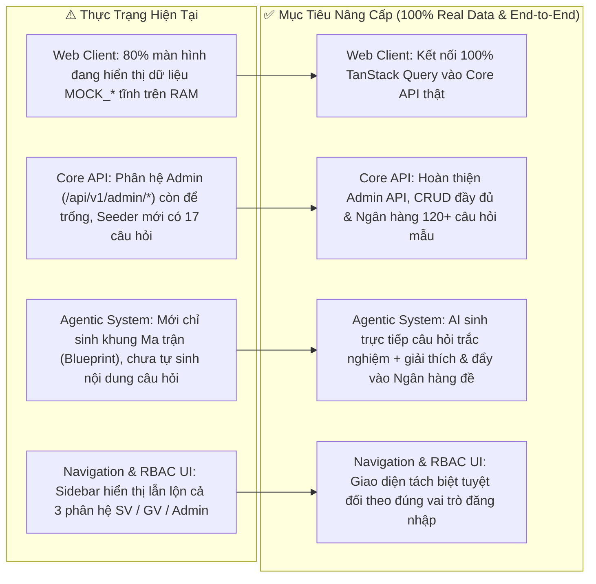
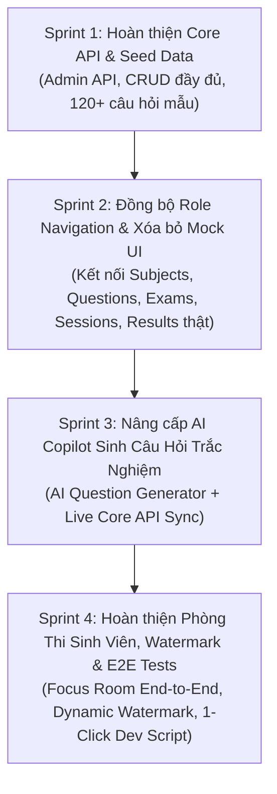

# 🚀 Kế Hoạch Cải Thiện & Nâng Cấp Toàn Diện Dự Án — Exam Platform (Next-Gen Roadmap)

**Dự án**: Exam Platform Monorepo (`core-api` + `web-client` + `agentic-system`)  
**Ngày lập báo cáo**: 2026-10-27  
**Tham chiếu Hiến pháp**: [`AGENTS.md`](AGENTS.md) & [`docs/07-testing-execution/23-IMPLEMENTATION_PLAN.md`](docs/07-testing-execution/23-IMPLEMENTATION_PLAN.md)  
**Đặc tả kỹ thuật chi tiết 4 Sprint**: [`docs/07-testing-execution/25-SPRINT_EXECUTION_SPECIFICATION.md`](docs/07-testing-execution/25-SPRINT_EXECUTION_SPECIFICATION.md)  
**Script khởi chạy tự động 1-click**: [`start-dev.ps1`](start-dev.ps1)  
**Trạng thái hiện tại**: Cả 3 phân hệ đã khởi chạy thông suốt, xác thực BFF hoạt động, luồng Trợ lý Soạn Đề AI (Gemini LLM + Human-in-the-Loop) đã chạy End-to-End và ghi vào CSDL thành công.

---

## 📊 1. Chẩn Đoán Thực Trạng Hệ Thống (Current State Audit & Gap Analysis)

Qua quá trình chạy thực tế và rà soát toàn bộ mã nguồn (Codebase Deep-Dive Audit), mặc dù kiến trúc nền tảng và bộ kiểm thử đơn vị (Unit/Feature Tests) đã đạt chuẩn cao, dự án hiện đang tồn tại **4 nhóm khoảng cách kỹ thuật lớn (Technical Gaps)** cần được xử lý triệt để để chuyển mình từ bản *Prototype chạy được* thành một *Sản phẩm Production thực thụ*:

---

## 🔥 2. Chi Tiết 5 Hạng Mục Cần Cải Thiện (Prioritized Improvement Pillars)

### Hạng Mục 1 (Ưu tiên P0 - Cấp bách nhất): Xóa Bỏ Dữ Liệu Giả Lập (`MOCK_*`) — Kết Nối 100% Frontend Với Core API

Hiện tại, Backend (`core-api/`) đã xây dựng xong 29 RESTful API endpoints rất chặt chẽ, nhưng hầu hết các trang trên `web-client/` vẫn đang đọc từ mảng hằng số `MOCK_*` trong `useState` cục bộ (khiến dữ liệu tạo mới ở trang này không xuất hiện ở trang kia và F5 trình duyệt sẽ mất dữ liệu).

| STT | Màn hình Frontend (`web-client/src/app/`) | Thực trạng hiện tại (Điểm nghẽn) | Giải pháp cải thiện & Endpoint kết nối |
| :-: | :--- | :--- | :--- |
| **1.1** | **Kho Đề Thi Mẫu** [`teacher/exams/page.tsx`](web-client/src/app/(workspace)/teacher/exams/page.tsx) | Đang dùng hằng số `MOCK_EXAM_TEMPLATES`. Khi tạo đề thi từ AI Assistant xong, bấm sang Kho Đề không thấy đề mới tạo. | Tạo hook `useExams()` gọi `GET /api/proxy/exams`, hiển thị danh sách đề thi thật từ CSDL kèm nút Xuất PDF (`GET /exams/{id}/export/pdf`). |
| **1.2** | **Môn Học & Chủ Đề** [`teacher/subjects/page.tsx`](web-client/src/app/(workspace)/teacher/subjects/page.tsx) | Đang dùng `INITIAL_SUBJECTS` cục bộ. Thêm/sửa/xóa môn học chỉ lưu tạm trên RAM trình duyệt. | Tạo hooks `useSubjects()`, `useCreateSubject()`, `useUpdateSubject()`, `useDeleteSubject()`, `useTopics()` kết nối trực tiếp `GET/POST/PATCH/DELETE /api/proxy/subjects`. |
| **1.3** | **Ngân Hàng Câu Hỏi** [`teacher/questions/page.tsx`](web-client/src/app/(workspace)/teacher/questions/page.tsx) | Đang dùng `MOCK_QUESTIONS` tĩnh (chỉ có modal Import Excel là gọi API thật). | Tạo hooks `useQuestions()`, `useCreateQuestion()`, `useUpdateQuestion()`, `useToggleQuestionStatus()` kết nối `GET/POST/PUT/PATCH /api/proxy/questions`. |
| **1.4** | **Quản Lý Ca Thi** [`teacher/sessions/page.tsx`](web-client/src/app/(workspace)/teacher/sessions/page.tsx) | Đang dùng `MOCK_SESSIONS` tĩnh. Thao tác Mở ca thi (Publish) / Đóng ca thi (Close) chưa gọi xuống Server. | Kết nối `GET/POST /api/proxy/exam-sessions`, `POST /exam-sessions/{id}/publish`, `POST /exam-sessions/{id}/close`, và gán sinh viên/giám thị. |
| **1.5** | **Phổ Điểm & Thống Kê** [`teacher/sessions/[id]/results/page.tsx`](web-client/src/app/(workspace)/teacher/sessions/[id]/results/page.tsx) | Đang dùng `MOCK_RESULTS` tĩnh, bỏ phí bộ máy thống kê `SessionAnalyticsService` rất mạnh ở Backend. | Kết nối `GET /api/proxy/exam-sessions/{id}/results` để vẽ phổ điểm thật, chỉ số Min/Max/Avg/Median/StdDev và độ phân biệt câu hỏi ($P, D$). |
| **1.6** | **Giám Sát Trực Tiếp** [`teacher/sessions/[id]/monitor/page.tsx`](web-client/src/app/(workspace)/teacher/sessions/[id]/monitor/page.tsx) | Đang hiển thị danh sách thí sinh giả lập tĩnh. | Kết nối `GET /api/proxy/exam-sessions/{id}/proctoring-summary` và `proctoring-events` với cơ chế tự động làm mới (`refetchInterval: 5000ms`). |
| **1.7** | **Trợ Lý Soạn Đề AI** [`teacher/ai-assistant/page.tsx`](web-client/src/app/(workspace)/teacher/ai-assistant/page.tsx) | Đang dùng `SAMPLE_SUBJECTS` và danh sách ID câu hỏi tĩnh `[1, 2, 3, 7, 9, 12, 15]`. | Tự động tải danh sách Môn học & Chủ đề thật từ `GET /api/proxy/subjects` và lọc câu hỏi hợp lệ theo đúng môn học từ CSDL. |
| **1.8** | **Kết Quả Thi Sinh Viên** [`student/results/page.tsx`](web-client/src/app/(workspace)/student/results/page.tsx) & [`[attemptId]/page.tsx`](web-client/src/app/(workspace)/student/results/[attemptId]/page.tsx) | Đang dùng `MOCK_PAST_RESULTS` và `MOCK_RESULT_DATA`. | Kết nối API lấy danh sách lịch sử bài làm của sinh viên và chi tiết điểm số từng câu sau khi nộp bài. |

---

### Hạng Mục 2 (Ưu tiên P0): Chuẩn Hóa Điều Hướng Theo Vai Trò (Strict Role-Based Navigation & Dashboard)

1. **Tách biệt Sidebar theo đúng Role đăng nhập ([`AppSidebar.tsx`](web-client/src/components/workspace/AppSidebar.tsx))**:
   - **Vấn đề**: Hiện tại Sidebar có nút lọc `"Tất cả | SV | GV | Admin"` và mặc định hiển thị toàn bộ menu của cả Sinh viên, Giảng viên lẫn Admin. Khi sinh viên đăng nhập vẫn nhìn thấy menu *"Quản trị Người dùng"* hay *"Trợ lý Soạn Đề AI"*.
   - **Giải pháp**: Đọc trực tiếp `user.role` từ `useCurrentUser()`:
     - Nếu `role === 'student'`: Chỉ hiển thị nhóm menu Sinh viên (*Ca thi của tôi, Lịch sử & Kết quả bài thi*).
     - Nếu `role === 'teacher'`: Chỉ hiển thị nhóm menu Giảng viên (*Tổng quan, Môn học & Chủ đề, Ngân hàng câu hỏi, Trợ lý Soạn Đề AI, Kho Đề thi, Lập lịch Ca thi, Giám sát & Báo cáo*).
     - Nếu `role === 'admin'`: Hiển thị nhóm menu Quản trị viên kèm quyền truy cập kiểm tra các phân hệ.
2. **Ẩn thanh chuyển đổi Role giả lập trên [`TopBar.tsx`](web-client/src/components/workspace/TopBar.tsx)**:
   - Xóa bỏ 3 pill chuyển nhanh `Sinh viên | Giảng viên | Quản trị` dành cho bản demo cũ trên thanh TopBar đối với tài khoản thường, thay bằng badge hiển thị chính xác vai trò được cấp phát bởi Server.
3. **Đồng bộ thông tin thật trên Bảng Điều Khiển ([`teacher/page.tsx`](web-client/src/app/(workspace)/teacher/page.tsx) & [`admin/page.tsx`](web-client/src/app/(workspace)/admin/page.tsx))**:
   - Thay thế tên giảng viên hardcode `"TS. Trần Minh Khoa"` bằng tên thật của user đang đăng nhập (`user.name`, ví dụ `"TS. Lê Hoàng Nam"`).
   - Hiển thị số lượng Môn học, Câu hỏi, Đề thi và Ca thi thực tế từ API.

---

### Hạng Mục 3 (Ưu tiên P1): Hoàn Thiện Các Endpoint Còn Thiếu Tại Backend (`core-api/`)

Rà soát tệp [`core-api/routes/api.php`](core-api/routes/api.php) cho thấy một số nhóm route quan trọng cần được bổ sung để hệ thống khép kín 100%:

1. **Triển khai nhóm Route Quản Trị Viên (`/api/v1/admin/*` — hiện đang để trống tại dòng 48)**:
   - `GET /api/v1/admin/users`: Danh sách người dùng có phân trang, tìm kiếm theo tên/email/mã định danh, lọc theo `role` và trạng thái `is_active`.
   - `POST /api/v1/admin/users`: Admin tạo tài khoản Giảng viên / Sinh viên / Admin mới.
   - `PATCH /api/v1/admin/users/{user}`: Cập nhật thông tin, đổi vai trò (`role`), hoặc khóa/mở khóa tài khoản (`is_active`).
   - `GET /api/v1/admin/audit-logs`: Truy xuất nhật ký kiểm toán hợp nhất từ bảng `ai_generation_logs` và các sự kiện hệ thống.
   - `GET /api/v1/admin/dashboard-stats`: Thống kê tổng số người dùng theo role, tổng số ca thi đang mở, tổng số lượt làm bài và cảnh báo vi phạm.
2. **Bổ sung các Endpoint CRUD chi tiết cho Giảng viên & Sinh viên**:
   - **Topics**: Bổ sung `PATCH /api/v1/topics/{topic}` (sửa tên/mô tả chủ đề) và `DELETE /api/v1/topics/{topic}` (xóa chủ đề khi chưa có câu hỏi).
   - **Exams**: Bổ sung `GET /api/v1/exams/{exam}` (xem chi tiết đề thi kèm danh sách câu hỏi đã gắn), `PATCH /api/v1/exams/{exam}` (cập nhật thông tin đề thi), và `DELETE /api/v1/exams/{exam}` (xóa đề thi nháp chưa gắn ca thi).
   - **Questions**: Bổ sung `GET /api/v1/questions/{question}` (lấy chi tiết câu hỏi để nạp vào form chỉnh sửa [`teacher/questions/[id]/edit/page.tsx`](web-client/src/app/(workspace)/teacher/questions/[id]/edit/page.tsx)) và `DELETE /api/v1/questions/{question}` (Soft Delete câu hỏi chưa gắn vào đề).
   - **Student Attempts History**: Bổ sung `GET /api/v1/student/attempts` (danh sách các lượt thi đã nộp kèm điểm số của sinh viên).
3. **Mở rộng Seeder Ngân Hàng Câu Hỏi ([`QuestionSeeder.php`](core-api/database/seeders/QuestionSeeder.php))**:
   - Hiện tại CSDL chỉ seed 17 câu hỏi (Môn 1: 7 câu, Môn 2: 6 câu, Môn 3: 4 câu).
   - Cần nâng cấp `QuestionSeeder` lên **120+ câu hỏi thực tế** (ít nhất 40 câu/môn, phân bổ chuẩn 40% Dễ, 40% Trung bình, 20% Khó trên 4 loại câu hỏi `single_choice`, `multiple_choice`, `true_false`, `short_answer`) để tính năng tạo đề thi 40 câu và trộn đề hoạt động đúng thực tế.

---

### Hạng Mục 4 (Ưu tiên P1): Nâng Cấp Sức Mạnh AI Copilot (`agentic-system/`)

Hiện tại `agentic-system` mới chỉ tạo **Ma trận Đề thi (Blueprint)** dựa trên số lượng câu hỏi. Để tính năng LLM thực sự đột phá cho Giảng viên, cần nâng cấp:

1. **Kỹ năng mới: AI Tự Động Biên Soạn Câu Hỏi Mới (`question-generation` Skill)**:
   - Cho phép Giảng viên nhập yêu cầu (VD: *"Hãy soạn 10 câu hỏi trắc nghiệm mới về chủ đề Khóa bi quan Pessimistic Locking trong PostgreSQL, mức độ Vận dụng"*).
   - Gemini LLM (`gemini-3.5-flash-lite`) tự động sinh danh sách câu hỏi đầy đủ:
     - Nội dung câu hỏi (`question_text`)
     - 4 phương án lựa chọn (`options`: A, B, C, D)
     - Đáp án đúng (`correct_answer`)
     - Lời giải thích học thuật chi tiết (`explanation`)
     - Phân loại độ khó Bloom (`easy` | `medium` | `hard`)
   - Hiển thị giao diện xem trước từng câu hỏi để Giảng viên chỉnh sửa nhanh và bấm **Phê duyệt (Human-in-the-Loop)** $\rightarrow$ Lưu hàng loạt vào Ngân hàng câu hỏi của Core API!
2. **Chuyển `EXAM_PLATFORM_MOCK=false` (Kết nối thật giữa Python Agent và Laravel Core API)**:
   - Cấu hình `ExamPlatformClient` trong `agentic-system` sử dụng Bearer Token của Giảng viên (truyền từ BFF Proxy qua header) để truy vấn số lượng câu hỏi thực tế đang có trong CSDL Core API khi lập kế hoạch soạn đề.
3. **Bộ Chuẩn Hóa JSON Schema Cho Gemini API (`Schema Dereferencer`)**:
   - Xây dựng hàm tiện ích tự động giải tham chiếu `$defs` (`$ref`) trong Pydantic JSON Schema trước khi gửi sang `generationConfig.responseSchema` của Gemini API, giúp LLM luôn trả về định dạng JSON chính xác tuyệt đối 100% mà không bao giờ gặp lỗi `400 Bad Request`.

---

### Hạng Mục 5 (Ưu tiên P2): Trải Nghiệm Phòng Thi, Đa Phương Tiện & Tự Động Hóa DevOps

1. **Triển khai Phase 15 — Câu hỏi Đa phương tiện & Watermark Chống Tuồn Đề**:
   - Hỗ trợ đính kèm hình ảnh minh họa cho câu hỏi và đáp án (`MediaUploadController`).
   - Phủ lớp **Dynamic Watermark** (`Mã SV + Mã Ca Thi + IP + Timestamp`) bán trong suốt lên màn hình phòng thi Focus Mode ([`exam/[attemptId]/page.tsx`](web-client/src/app/exam/[attemptId]/page.tsx)) để răn đe và truy vết hành vi chụp ảnh màn hình đề thi.
2. **Hoàn thiện Luồng Thi Thật End-to-End Cho Sinh Viên**:
   - Đảm bảo từ trang `/student/exams` $\rightarrow$ Bấm *"Vào phòng thi"* (`POST /api/v1/exam-sessions/{id}/attempts`) $\rightarrow$ Chuyển hướng vào `/exam/{attemptId}` $\rightarrow$ Tải đề thi thật từ Server (ẩn hoàn toàn `correct_answer`) $\rightarrow$ Tự động lưu đáp án (`PATCH /answers` debounce 500ms) $\rightarrow$ Tự động gửi sự kiện giám sát khi chuyển tab (`POST /proctoring-events`) $\rightarrow$ Nộp bài (`POST /submit`) $\rightarrow$ Xem biên nhận và điểm số thật tại `/exam/{attemptId}/receipt` và `/student/results/{attemptId}`.
3. **Kịch bản Khởi Chạy Tự Động 1-Click (`start-dev.ps1`)**:
   - Tạo script PowerShell tại thư mục gốc giúp khởi chạy đồng thời cả 3 dịch vụ (`core-api :8000`, `agentic-system :8001`, `web-client :3000`), kiểm tra healthcheck tự động và in bảng thông tin đăng nhập chỉ bằng một câu lệnh duy nhất.

---

## 🗺️ 3. Lộ Trình Thực Thi Đề Xuất (Actionable Execution Plan)

Để triển khai gọn gàng, an toàn và tuân thủ nguyên tắc *"Mỗi bước tiến đều kiểm thử PASS 100%"* của `AGENTS.md`, lộ trình cải thiện được chia thành **4 Sprint ngắn**:

### 📋 Danh sách Công việc Chi tiết (Checklist Nghiệm Thu):

- [ ] **Sprint 1 — Backend Completeness & Rich Seeding (`core-api/`)**:
  - [ ] Bổ sung `GET /api/v1/exams/{exam}`, `PATCH /api/v1/exams/{exam}`, `DELETE /api/v1/exams/{exam}`.
  - [ ] Bổ sung `GET /api/v1/questions/{question}`, `DELETE /api/v1/questions/{question}`.
  - [ ] Bổ sung `PATCH /api/v1/topics/{topic}`, `DELETE /api/v1/topics/{topic}`.
  - [ ] Bổ sung `GET /api/v1/student/attempts` (lịch sử làm bài của sinh viên).
  - [ ] Triển khai `AdminController` (`/api/v1/admin/users`, `/api/v1/admin/audit-logs`, `/api/v1/admin/stats`).
  - [ ] Mở rộng `QuestionSeeder.php` lên 60–120 câu hỏi phủ đều các môn học và chủ đề.
- [ ] **Sprint 2 — Frontend Live Data Integration (`web-client/`)**:
  - [ ] Cập nhật `AppSidebar.tsx` và `TopBar.tsx` lọc menu nghiêm ngặt theo `user.role`.
  - [ ] Kết nối API thật cho trang `teacher/subjects/page.tsx` (Môn học & Chủ đề).
  - [ ] Kết nối API thật cho trang `teacher/questions/page.tsx` và `new/edit` (Ngân hàng câu hỏi).
  - [ ] Kết nối API thật cho trang `teacher/exams/page.tsx` và `[id]/edit` (Đề thi mẫu — hiển thị ngay đề thi do AI tạo).
  - [ ] Kết nối API thật cho trang `teacher/sessions/page.tsx`, `monitor` và `results`.
  - [ ] Kết nối API thật cho trang `admin/users/page.tsx`, `admin/audit-logs/page.tsx`, `admin/page.tsx`.
- [ ] **Sprint 3 — AI Question Generation & Live Agent (`agentic-system/` + `web-client/`)**:
  - [ ] Thêm chế độ **"AI Soạn Câu Hỏi Mới"** vào `agentic-system` (sinh câu hỏi + 4 đáp án + giải thích bằng Gemini LLM).
  - [ ] Kết nối `teacher/ai-assistant/page.tsx` với danh sách Môn học & Chủ đề thật từ Core API.
  - [ ] Cho phép lưu bộ câu hỏi do AI sinh ra trực tiếp vào Ngân hàng câu hỏi sau khi Giảng viên bấm Approve.
- [ ] **Sprint 4 — Student Exam Flow, Anti-Leak Watermark & Dev Automation**:
  - [ ] Kết nối trang `/student/exams`, `/exam/[attemptId]`, và `/student/results` chạy dữ liệu thật xuyên suốt.
  - [ ] Thêm lớp phủ Dynamic Watermark (`student_code + IP + timestamp`) trong phòng thi Focus Mode.
  - [ ] Tạo script `start-dev.ps1` khởi động toàn bộ hệ thống với 1 lệnh.

