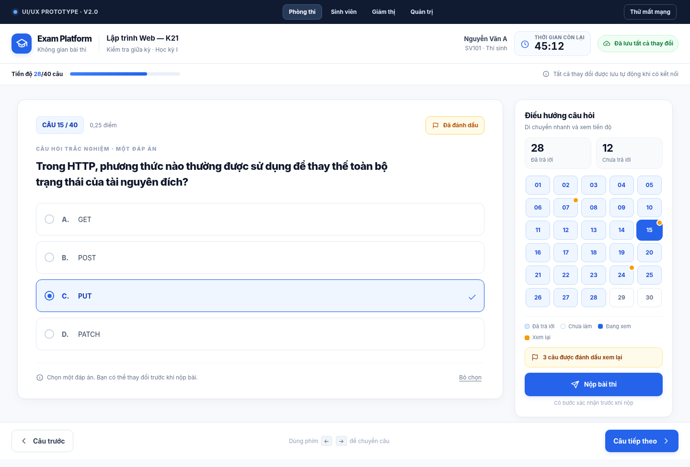

# 🎓 ThiSmart — Enterprise Online Examination & Assessment System

<div align="center">

  

  <br />

  [](core-api/)
  [](core-api/)
  [](docs/02-domain-database/)
  [](web-client/)
  [](web-client/)
  [](agentic-system/)
  [](agentic-system/)
  [](docker/)
  [](core-api/tests/)

  <p><strong>Thi thông minh. Đánh giá chính xác.</strong><br />
  <em>Enterprise Monorepo Online Examination Platform integrated with ExamOps AI Copilot for intelligent orchestration.</em></p>

</div>

---

## 🖥️ Focus Exam Room (Online Examination Interface)

Giao diện làm bài thi trực tuyến chuyên dụng triệt tiêu mọi distracting elements, bảo đảm **Server-Authoritative Clock**, cơ chế **Debounced Autosave (500ms)** thời gian thực với **Idempotent Upsert**, và **Interactive Question Palette / Navigator**:

<div align="center">
  
  <p><em>Focus Exam Room Desktop Interface (1440×976) — Maximum Focus, Real-time Answer Synchronization & Zero-Leakage Architecture</em></p>
</div>

---

## 📌 Project Overview & System Scope

- **Vietnamese Project Title**: Xây dựng RESTful API cho hệ thống thi trực tuyến bằng Laravel kết hợp AI Copilot điều phối khảo thí.
- **English Project Title**: **Exam Platform API: A Laravel RESTful Backend & AI-Assisted Orchestration for Online Examination Management**.
- **Scope & Core Capabilities**:
  - **Stateless Authentication & Authorization**: Laravel Sanctum Bearer Tokens, Role-Based Access Control (RBAC), và Policy-Based Access Control (PBAC) triệt tiêu Insecure Direct Object References (IDOR / BOLA).
  - **Academic Taxonomy**: Cây phân cấp học thuật Môn học (`Subject`) và Chủ đề kiến thức (`Topic`).
  - **Question Bank Management**: 4 loại câu hỏi chuẩn (`single_choice`, `multiple_choice`, `true_false`, `short_answer`) kèm **Bulk Excel Import (`.xlsx`)** và row-by-row syntax validation.
  - **Exam Blueprint & AI Copilot**: Soạn đề thi mẫu (`Exam`) và tự động sinh ma trận câu hỏi bằng ExamOps AI Copilot (Bloom Taxonomy, Difficulty Distribution, Human-in-the-Loop Approval Gate).
  - **Exam Session Scheduling**: Quản lý vòng đời ca thi (`ExamSession`), Proctor Assignment (`SessionTeacher`), và Candidate Assignment (`SessionAssignment`).
  - **Concurrency Control & Exam Taking**: Quản lý lượt thi (`ExamAttempt`), Real-time Idempotent Answer Upsert, và Double-Submit Prevention thông qua **Pessimistic Locking (`lockForUpdate()`)** và ACID Database Transactions.
  - **Anti-Cheat & Proctoring Engine**: Thu thập tín hiệu cảm biến thời gian thực (`ProctoringEvents`: `tab_hidden`, `fullscreen_exit`, `blur`) phục vụ hậu kiểm (Auditing).
  - **Automated Scoring & Reporting**: Chấm điểm tự động qua `AttemptScorer`, thống kê Score Distribution, và xuất bản Official Gradebook & Exam Sheet (PDF & Excel formats).

---

## 🏗️ Monorepo Architecture & Application Blocks

Hệ thống được tổ chức theo kiến trúc **Monorepo** với ranh giới trách nhiệm (Separation of Concerns) nghiêm ngặt:

```text
PHP/
├── core-api/          # Backend RESTful API (Laravel 13, PHP 8.3+, PostgreSQL 16) — SOURCE OF TRUTH (SoR)
├── web-client/        # Frontend Web Client ThiSmart (Next.js 15+ App Router, React 19, Tailwind CSS)
├── agentic-system/    # ExamOps AI Copilot (Python 3.11+, FastAPI, LangGraph, Human-in-the-Loop Gate)
├── docker/            # Containerization Orchestration (PHP-FPM, Nginx, Node.js, PostgreSQL, Agent)
├── docs/              # 8 Architecture & Technical Specification Directories
└── AGENTS.md          # Technical Constitution & Engineering Standards
```

| Application / Module | Core Tech Stack | Architectural Responsibility |
| :--- | :--- | :--- |
| **`core-api/`** | Laravel 13, PHP 8.3, PostgreSQL 16, Redis 7, Sanctum | **Single Source of Truth (System of Record - SoR)**: Quản lý toàn bộ Business Logic, Transaction Boundaries, Concurrency Locking, Scoring Engine, và Data Integrity. |
| **`web-client/`** | Next.js 15+ (App Router), React 19, TypeScript Strict, TanStack Query v5 | **Presentation Layer**: ThiSmart User Interface, Dual Shell (Workspace & Focus Exam Room), Server State Management, và Client-side Event Listeners. |
| **`agentic-system/`** | Python 3.11+, FastAPI, LangGraph, Pydantic v2, HTTPX | **Intelligent Orchestration Layer**: AI Copilot sinh ma trận đề thi, deterministic math validation, và Human-in-the-Loop Approval Gate. |
| **`docker/`** | Docker & Docker Compose | **Infrastructure & Containerization**: Môi trường container đồng bộ cho Local Development và Multi-stage Production Deployments. |
| **`docs/`** | Markdown, C4 Model, Mermaid Diagrams, ADRs | **Technical Documentation**: 8 phân hệ đặc tả từ Requirements, Database Schemas, API Contracts, Threat Models đến Implementation Plans. |

---

## 👥 System Actors & Roles (RBAC Matrix)

```text
┌─────────────────┐       ┌─────────────────┐       ┌─────────────────┐
│      Admin      │       │     Teacher     │       │     Student     │
│ (System Admin)  │       │ (Lecturer/Exam) │       │ (Test Candidate)│
└────────┬────────┘       └────────┬────────┘       └────────┬────────┘
         │                         │                         │
         ├─ User Management & RBAC ├─ Subject Ownership      ├─ View Assigned Sessions
         ├─ System Configurations  ├─ Question Bank Authoring├─ Enter Focus Exam Room
         ├─ Reassign Subject Owner ├─ Exam Blueprint & AI    ├─ Debounced Autosave (500ms)
         └─ Global Audit & Logs    ├─ Session Scheduling     ├─ Submit with Concurrency Lock
                                   └─ Export Gradebook PDF   └─ Stream Proctoring Signals
```

---

## 🧩 Core Domain Model & Relational Hierarchy

Cây quan hệ dữ liệu cốt lõi tuân thủ **Referential Integrity** và chuẩn hóa CSDL (3NF):

```text
Subject (Môn học / Academic Discipline)
  └── Topic (Chủ đề kiến thức / Knowledge Unit)
        └── Question (Ngân hàng câu hỏi: single_choice, multiple_choice, true_false, short_answer)
              │
              ├── ExamQuestion (Pivot Table: metadata vị trí hiển thị 'order' & thang điểm 'points')
              │     └── Exam (Đề thi mẫu / Blueprint Template: duration_minutes, passing_score, shuffle_questions)
              │           └── ExamSession (Ca thi cụ thể: FSM draft → published → in_progress → closed)
              │                 │
              │                 ├── SessionAssignment (Phân bổ thí sinh: Composite Unique 'exam_session_id + student_id')
              │                 ├── SessionTeacher (Phân công cán bộ coi thi / Proctor Assignment)
              │                 │
              │                 └── ExamAttempt (Lượt làm bài: FSM in_progress → submitted → graded)
              │                       │
              │                       ├── AttemptAnswer (Idempotent Upsert: Composite Unique 'attempt_id + question_id')
              │                       ├── ProctoringEvent (Audit Log: tab_hidden, fullscreen_exit, blur)
              │                       └── Score / Result (Calculated Points, Percentage & Grade Classification)
```

---

## 🔄 Core Workflows & Lifecycles

### 1. Teacher & Examination Lifecycle
```text
Stateless Authentication (Sanctum Bearer Token)
  ↓
Create Subject & Topics (Auto-bind owner_teacher_id)
  ↓
Question Authoring or Bulk Excel Import (Row-by-Row Syntax & Type Validation)
  ↓
Design Exam Template (Manual Blueprint or AI Copilot Matrix Generation)
  ↓
Schedule Exam Session (Define start_at, end_at, duration_minutes)
  ↓
Assign Proctors (SessionTeacher) & Assign Candidates (SessionAssignment)
  ↓
Publish Exam Session (Validation Gate: Verify question points & candidate count)
  ↓
Live Proctoring & Candidate Progress Monitoring
  ↓
Session Finalization & Export Official Reports (Excel Gradebook & PDF Exam Transcripts)
```

### 2. Student Exam-Taking Workflow
```text
Student Authentication (Sanctum Token)
  ↓
Query Assigned Sessions (Filtered by Current Server Window)
  ↓
Start Exam Attempt (Validate Session Status, Allowed Window, Generate Deadline)
  ↓
Enter Focus Exam Room (Fetch Question Payload under Zero-Leakage Policy)
  ↓
Take Exam with Debounced Autosave (500ms Idempotent Upsert to attempt_answers)
  ↓
Stream Proctoring Signals (visibilitychange, fullscreenchange, window blur)
  ↓
Submit Attempt (ACID Transaction + Pessimistic Locking 'lockForUpdate()')
  ↓
Automated Scoring Engine (AttemptScorer computes weighted score)
  ↓
View Results & Performance Breakdown (Subject to Session Publish Policy)
```

### 3. ExamOps AI Deterministic Orchestration Loop
```text
Teacher Inputs Pedagogical Goal (Bloom Taxonomy, Target Question Count, Difficulty Distribution)
  ↓
[Step 1 - Intake]: Parse goal, validate constraints, verify actor authorization (SubjectPolicy)
  ↓
[Step 2 - Plan]: Select domain skill 'exam-blueprint' and build Least-Privilege Tools Allowlist
  ↓
[Step 3 - Execute]: Safe read-only queries against Core API via typed HTTPX client
  ↓
[Step 4 - Verify]: Deterministic verification (sum % = 100, positive integers, deduplication)
  ↓
[Step 5 - Human Review]: INTERRUPT & PAUSE AT APPROVAL GATE (Status: WAITING_FOR_APPROVAL)
  ↓
Teacher reviews proposed Blueprint on Web Client and triggers Approve
  ↓
[Step 6 - Finalize]: Core API generates Exam Template and materializes ExamQuestions in DB
```

---

## ⚡ Backend Request Lifecycle (Controller as Orchestrator)

Core API tuân thủ nghiêm ngặt nguyên tắc **Clean Layered Architecture** và **Thin Controller / Rich Domain**:

```text
HTTP Request (/api/v1/...)
    ↓
Routing Layer (routes/api.php)
    ↓
Route & Global Middleware (CORS, EnsureActiveUser, RoleMiddleware:admin|teacher|student)
    ↓
Authentication Guard (Laravel Sanctum Bearer Token / HttpOnly Cookie Proxy)
    ↓
Form Request Validation (app/Http/Requests/... -> $request->validated())
    ↓
Policy Authorization ($this->authorize(...) -> Mitigates IDOR / BOLA)
    ↓
Single-Responsibility Action (app/Actions/... -> Encapsulates Business Logic)
    ↓
Database Transaction & Concurrency Control (DB::transaction() + lockForUpdate())
    ↓
Eloquent ORM & Query Optimization (Eager Loading with() -> Mitigates N+1 Query)
    ↓
PostgreSQL 16 Engine / Redis 7 Cache & Rate Limiting (throttle:60,1)
    ↓
API Resource Layer (Segregated QuestionAdminResource vs QuestionStudentResource -> Zero-Leakage)
    ↓
Standardized JSON Response (Envelopes with HTTP Status Codes: 200, 201, 401, 403, 409, 422)
```

---

## 🏛️ Sơ Đồ Kiến Trúc Hệ Thống (System Architecture)

<div align="center">
  
  <p><em>4-Tier System Architecture: Client Layer (Web Client) → Gateway & Reverse Proxy (Nginx) → Backend Services (Laravel Core API & FastAPI ExamOps Agent) → Persistence Layer (PostgreSQL 16, Redis 7, SQLite Checkpoints)</em></p>
</div>

---

## 🚀 Quick Start & Container Orchestration

### 1. Khởi động toàn bộ Services qua Docker Compose

Hệ thống đã cấu hình sẵn 5 container đồng bộ:

```bash
# Khởi chạy toàn bộ cụm container trong background
docker compose up -d
```

Các Endpoint & Services khả dụng:
- 🌐 **Web Client (ThiSmart)**: [http://localhost:3000](http://localhost:3000)
- 🔌 **Core REST API**: [http://localhost:8000/api/v1](http://localhost:8000/api/v1)
- 📖 **OpenAPI 3.1 / Swagger UI**: [http://localhost:8000/docs/api](http://localhost:8000/docs/api)
- 🤖 **ExamOps AI Agent**: [http://localhost:8001](http://localhost:8001)
- 🐘 **PostgreSQL 16**: `localhost:5432` (database: `exam_platform`, user: `postgres`, pass: `secret`)

---

### 2. Database Migrations & Initial Setup

```bash
# 1. Chạy Migrations và nạp Seed Data vào PostgreSQL 16
docker compose exec app php artisan migrate --seed

# 2. Tạo Storage Symlink cho Uploaded Assets (Excel templates, PDFs)
docker compose exec app php artisan storage:link
```

---

### 3. Automated Test Suites & Static Analysis

Hệ thống sở hữu bộ kiểm thử tự động toàn diện đạt tỷ lệ **PASS 100%**:

```bash
# 1. Backend Core API Feature Tests (170 tests, >1100 assertions PASS)
docker compose exec app php artisan test

# 2. PHP Code Style Formatting & Static Analysis (Pint PSR-12 & Larastan Level 5/8)
docker compose exec app ./vendor/bin/pint --test
docker compose exec app ./vendor/bin/phpstan analyse --level=5

# 3. ExamOps AI Agent Evaluation Scenarios (36/36 tests PASS in 0.75s)
docker compose exec agent pytest tests/evals/test_eval_suite.py

# 4. Frontend Type Checking (TypeScript Strict Mode - 0 errors)
docker compose exec client npm run typecheck
```

---

## ⚖️ Giấy Phép & Bản Quyền (License & Governance)

Dự án phát triển phục vụ mục đích nghiên cứu, học thuật và chuẩn hóa năng lực kỹ thuật công nghệ cao cho hệ thống Khảo thí Trực tuyến hiện đại. Chi tiết toàn bộ 8 phân hệ tài liệu kỹ thuật được tổ chức tại [`docs/`](docs/README.md).

Mọi đóng góp mã nguồn phải tuân thủ nghiêm ngặt theo **[Hiến pháp Kỹ thuật AGENTS.md](AGENTS.md)** và **[Quy chuẩn Commit COMMIT_STANDARDS.md](docs/08-guidelines/COMMIT_STANDARDS.md)**.
