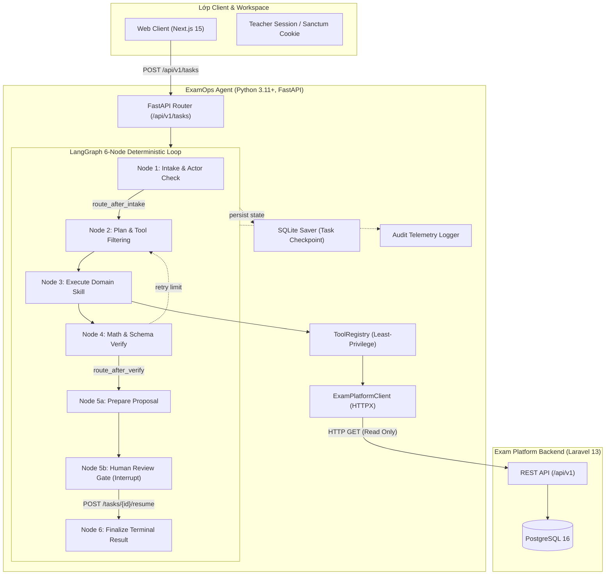

# Kiến Trúc Hệ Thống ExamOps Agent (Architecture Specification)

Hệ thống **ExamOps Agent** là microservice độc lập chịu trách nhiệm hỗ trợ Giảng viên và Quản trị viên trong việc thiết kế ma trận đề thi mẫu (Blueprint), thẩm định chất lượng khảo thí (Readiness Review) và tự động hóa điều phối tác vụ thi cử theo quy trình khép kín có kiểm soát (**Human-in-the-Loop**).

---

## 🏛️ 1. Sơ Đồ Kiến Trúc Tổng Thể (System Architecture)



---

## 🧩 2. Cấu Trúc Phân Lớp Mã Nguồn (Clean Architecture Layout)

Mã nguồn được tổ chức theo mô hình phân tách trách nhiệm cao cấp:

```text
agentic-system/
├── src/examops/
│   ├── api/                 # Tầng giao tiếp REST API
│   │   ├── __init__.py
│   │   └── routes.py        # Endpoints: /tasks, /tasks/{id}, /resume, /health
│   ├── nodes/               # 6 Nodes của chu trình LangGraph
│   │   ├── __init__.py
│   │   ├── intake.py        # Node 1: Kiểm tra Actor Role & Intent
│   │   ├── plan.py          # Node 2: Chọn Skill & Lọc Tools được phép
│   │   ├── execute.py       # Node 3: Thực thi ExamBlueprint hoặc ReadinessReview
│   │   ├── verify.py        # Node 4: Thẩm định toán học Bloom & phân bổ độ khó
│   │   ├── approval.py      # Node 5a & 5b: Tạo Proposal & Cổng duyệt Human Review
│   │   └── finalize.py      # Node 6: Chốt trạng thái và sinh FinalResult
│   ├── tools/               # Quản lý công cụ tương tác
│   │   ├── __init__.py
│   │   ├── contracts.py     # ToolContract, RegisteredTool, ToolExecutionError
│   │   └── registry.py      # ToolRegistry với chính sách Least-Privilege
│   ├── services/            # Tầng dịch vụ hạ tầng
│   │   ├── __init__.py
│   │   ├── llm.py           # Factory ModelProvider (Mock, Gemini, OpenAI)
│   │   └── platform.py      # ExamPlatformClient (HTTPX kết nối Laravel)
│   ├── models/              # Lớp thực thể dữ liệu Pydantic
│   │   ├── __init__.py
│   │   └── schemas.py       # ActorContext, ExamBlueprint, ReadinessReview...
│   ├── config.py            # Cấu hình Pydantic-Settings
│   ├── graph.py             # Lắp ráp StateGraph & Compiler
│   ├── main.py              # Khởi tạo FastAPI App, CORS & Telemetry
│   ├── persistence.py       # SQLite Checkpointer
│   ├── permissions.py       # Ma trận quyền hạn Actor RBAC
│   ├── skills.py            # Logic nghiệp vụ miền khảo thí
│   ├── state.py             # AgentState TypedDict
│   └── telemetry.py         # OpenTelemetry Audit Log
├── tests/                   # Bộ kiểm thử tự động
│   ├── unit/                # Unit tests cho skills, verification, tools, config
│   ├── integration/         # Integration tests cho API, graph flow, persistence
│   └── evals/               # Bộ lượng giá 8 kịch bản nghiệp vụ khảo thí
├── docs/                    # Tài liệu kỹ thuật chi tiết
│   ├── 01-ARCHITECTURE.md
│   ├── 02-AGENT-LOOP.md
│   ├── 03-TOOL-AND-SKILL-CONTRACTS.md
│   ├── 04-SECURITY-AND-VERIFICATION.md
│   └── guide/               # Technical Guidebook 10 chương chuyên sâu
├── eval/                    # Khung báo cáo đánh giá định lượng
│   └── results/report.md
├── presentation/            # Pitch deck và tài liệu demo
├── scripts/                 # Scripts tự động cài đặt môi trường
├── Dockerfile               # Build multi-stage chuẩn production
├── Makefile                 # Lệnh vận hành tự động (run, test, lint, format)
├── pyproject.toml           # Quản lý phụ thuộc và cấu hình công cụ
└── README.md                # Tài liệu hướng dẫn sử dụng nhanh
```

---

## 🔄 3. Chu Trình Điều Phối 6 Bước (6-Node Agent Loop)

1. **Node 1 (`intake`)**: Tiếp nhận yêu cầu tự nhiên của giảng viên, trích xuất mục tiêu sư phạm (`AgentGoal`), đối chiếu ma trận quyền hạn vai trò (`ActorContext`).
2. **Node 2 (`plan`)**: Lựa chọn kỹ năng miền (`ExamBlueprintSkill` hoặc `ExamReadinessReviewSkill`) và lọc danh sách công cụ theo chính sách đặc quyền tối thiểu (**Least-Privilege**).
3. **Node 3 (`execute`)**: Thực thi phân tích nghiệp vụ, tính toán phân bổ độ khó theo thang đo Bloom và kiểm tra ngân hàng câu hỏi qua `ExamPlatformClient`.
4. **Node 4 (`verify`)**: **Thẩm định toán học tất định (Deterministic Verification)** — kiểm tra tổng điểm = 10.0, tổng tỷ lệ độ khó = 100%, tỷ lệ câu hỏi hợp lệ. Nếu sai lệch, tự động kích hoạt cơ chế tự sửa lỗi (**Self-Correction Retry Loop** tối đa 3 lần).
5. **Node 5a & 5b (`approval`)**: 
   - 5a: Đóng gói đề xuất thành `ApprovalProposal` kèm chữ ký số học SHA-256 (`proposal_hash`).
   - 5b: Tạm dừng đồ thị trạng thái tại cổng duyệt **Human-in-the-Loop** bằng cơ chế `interrupt()`, lưu snapshot vào SQLite.
6. **Node 6 (`finalize`)**: Sau khi Giảng viên gửi quyết định Approve/Reject, đồ thị phục hồi trạng thái, cập nhật kết quả cuối cùng (`FinalResult`) và ghi log kiểm toán an ninh.

---

## 🔒 4. Ranh Giới An Ninh & IDOR Defense

- **Fail-Closed Boundary**: AI Agent tuyệt đối không có thông tin kết nối tới PostgreSQL, mọi truy vấn đọc/ghi đều qua REST API chuẩn của Laravel Core.
- **Human Approval Gate**: Thao tác ghi chỉ được thực hiện khi Giảng viên bấm Approve trên giao diện web client.
- **Replay Protection**: Cặp `[thread_id, proposal_hash]` ngăn ngừa việc gửi trùng lặp hoặc nạp lại đề thi đã xuất bản.

---

## ⚖️ 5. Quyết Định Kiến Trúc (Architecture Decision Log)

| Tiêu chí | Giải pháp được chọn | Lý do kỹ thuật |
|---|---|---|
| **API Framework** | FastAPI (Async) | Hỗ trợ Pydantic v2 type-safe, Swagger OpenAPI tự động, hiệu năng I/O bất đồng bộ cao. |
| **Agent Framework** | LangGraph (StateGraph) | Hỗ trợ quản lý trạng thái có chu kỳ, ngắt quãng Human-in-the-Loop tự nhiên và bền bỉ. |
| **State Persistence** | SQLite Checkpointer | Nhẹ, phi tập trung, độc lập với Redis của Exam Platform, không gây rủi ro nghẽn tài nguyên. |
| **Data Validation** | Pydantic v2 Strict | Ngăn ngừa rò rỉ dữ liệu, đảm bảo contract đồng bộ 100% giữa Python và TypeScript. |
| **Linter & Formatter** | Ruff | Tốc độ phân tích cực nhanh (<0.1s), thay thế flake8, black, isort trong 1 công cụ duy nhất. |
