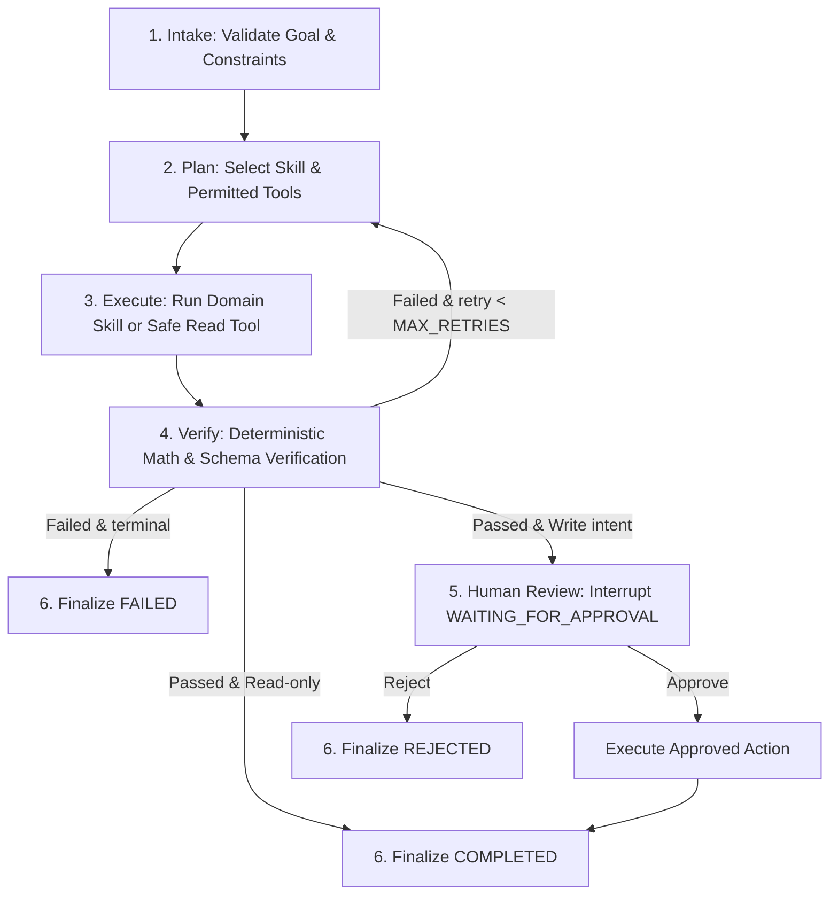

# ExamOps Agent — Intelligent Orchestration Layer

Dịch vụ AI Agent điều phối thông minh cho Hệ thống Thi Trực Tuyến (**Exam Platform**), xây dựng bằng **Python 3.11+**, **FastAPI**, **LangGraph**, và **Pydantic**.

---

## 🎯 1. Vai Trò & Ranh Giới Kiến Trúc

- **Lớp Điều Phối Thông Minh (Intelligent Orchestration Layer)**: ExamOps Agent không thay thế backend Laravel. Mọi dữ liệu chân lý (**System of Record - SoR**) như đề thi, ngân hàng câu hỏi, ca thi và điểm số thuộc quyền quản lý độc quyền của `core-api/` (Laravel 13 & PostgreSQL 16).
- **Ranh giới dữ liệu (Strict Boundary)**:
  ```text
  User / Teacher / Admin
            ↓
    FastAPI ExamOps (agentic-system)
            ↓
    StateGraph (6-step deterministic loop)
            ↓
    Skills & Tools Registry (Allowlist)
            ↓
    ExamPlatformClient (HTTPX, typed contracts)
            ↓ [RESTful API /api/v1]
    Laravel Core API (PostgreSQL 16)
  ```
- **Nguyên tắc an toàn (Fail-Closed & Zero-Leakage)**:
  - Agent **tuyệt đối không đọc trực tiếp** database PostgreSQL của Exam Platform.
  - Checkpoint lưu trữ độc lập tại SQLite riêng (`data/checkpoints.db`).
  - Mọi thao tác Ghi (`requires_write = True`) bắt buộc phải dừng lại ở cổng duyệt **Human-in-the-Loop** (`WAITING_FOR_APPROVAL`).
  - Tuyệt đối không log hoặc lưu trữ token, secret hay đáp án đúng (`correct_answer`).

---

## 🏗️ 2. Chu Trình Điều Phối 6 Bước (Deterministic Agent Loop)



1. **Intake**: Phân tích cú pháp, trích xuất `AgentGoal`, kiểm tra quyền của `actor`.
2. **Plan**: Xác định kỹ năng miền (`exam-blueprint` hoặc `exam-readiness-review`) và danh mục công cụ cho phép.
3. **Execute**: Thực thi tác vụ nguyên tử hoặc truy vấn dữ liệu từ API.
4. **Verify**: Thẩm định toán học (tổng tỷ lệ % = 100%, số câu nguyên dương, deduplication, status approved).
5. **Human Review**: Cổng ngắt (`interrupt`) tự động khi có đề xuất ghi dữ liệu hoặc tác động phòng thi.
6. **Finalize**: Đóng gói `FinalResult` kèm bằng chứng xác thực (`VerificationResult`) và cập nhật trạng thái terminal.

---

## 📂 3. Cấu Trúc Thư Mục Chuẩn (Directory Layout)

```text
agentic-system/
├── pyproject.toml              # Cấu hình dự án Python & dependencies (uv)
├── .env.example                # Biến môi trường mẫu
├── .gitignore                  # Bỏ qua venv, cache, database checkpoints
├── README.md                   # Tài liệu hướng dẫn này
├── data/                       # Thư mục lưu trữ SQLite checkpoints cục bộ
│   └── .gitignore
├── src/examops/                # Mã nguồn chính
│   ├── __init__.py
│   ├── main.py                 # FastAPI application & REST endpoints
│   ├── config.py               # Cấu hình Pydantic Settings
│   ├── schemas.py              # Pydantic Schemas & DTOs
│   ├── state.py                # AgentState 18 trường dữ liệu
│   ├── graph.py                # LangGraph StateGraph builder & router
│   ├── model.py                # ModelProvider Protocol (Mock, Gemini, OpenAI)
│   ├── platform_client.py      # HTTPX safe client gọi core-api
│   ├── tools.py                # Tool Registry & typed contracts
│   ├── skills.py               # Kỹ năng miền (Blueprint, Readiness Review)
│   ├── verification.py         # Thẩm định deterministic & toán học
│   ├── permissions.py          # Kiểm tra phân quyền Least-Privilege
│   ├── persistence.py          # Quản lý vòng đời SQLite Checkpointer
│   └── telemetry.py            # OpenTelemetry & Structured Audit Events
├── tests/                      # Bộ kiểm thử tự động
│   ├── __init__.py
│   ├── conftest.py             # Fixtures dùng chung
│   ├── unit/                   # Kiểm thử đơn vị (Schemas, Skills, Verification...)
│   ├── integration/            # Kiểm thử tích hợp (API, Graph flow, Checkpoints)
│   └── evals/                  # 6 kịch bản Evaluation Suite chuẩn mực
└── docs/                       # Tài liệu kỹ thuật chi tiết
    ├── 01-ARCHITECTURE.md
    ├── 02-AGENT-LOOP.md
    ├── 03-TOOL-AND-SKILL-CONTRACTS.md
    └── 04-SECURITY-AND-VERIFICATION.md
```

---

## 🚀 4. Hướng Dẫn Cài Đặt & Khởi Chạy

### Yêu cầu tiên quyết:
- **Python**: `>= 3.11` (khuyên dùng Python 3.11 - 3.13)
- **uv**: Trình quản lý gói & môi trường Python siêu tốc

### Các bước cài đặt:

```bash
# 1. Di chuyển vào thư mục agentic-system
cd agentic-system

# 2. Khởi tạo môi trường ảo và cài đặt dependencies
uv sync --all-extras

# 3. Sao chép cấu hình môi trường
cp .env.example .env

# 4. Khởi chạy máy chủ phát triển
uv run uvicorn examops.main:app --reload --host 127.0.0.1 --port 8000
```

### Chạy kiểm thử tự động (Test Suite):

```bash
# Chạy toàn bộ Unit, Integration và Eval tests
uv run pytest -v

# Chạy kiểm tra định dạng và linter
uv run ruff check .
uv run ruff format --check .

# Kiểm tra kiểu dữ liệu tĩnh (Static Type Check)
uv run mypy src
```

---

## 📡 5. API Endpoints

| Phương thức | Endpoint | Mô tả |
| :--- | :--- | :--- |
| `GET` | `/health` | Kiểm tra tình trạng sức khỏe dịch vụ & phiên bản |
| `POST` | `/api/v1/tasks` | Tiếp nhận và khởi tạo tác vụ điều phối mới |
| `GET` | `/api/v1/tasks/{thread_id}` | Truy vấn trạng thái tác vụ và đề xuất phê duyệt |
| `POST` | `/api/v1/tasks/{thread_id}/resume` | Gửi quyết định phê duyệt (`approve`/`reject`) để tiếp tục tác vụ |

---

## 📚 6. Tài Liệu Tham Chiếu

- [`docs/agentic-ai/00-FOUNDATION_DESIGN.md`](../docs/agentic-ai/00-FOUNDATION_DESIGN.md) — Bản thiết kế nền tảng đã được phê duyệt.
- [`AGENTS.md`](../AGENTS.md) — Hiến pháp Kỹ thuật toàn dự án Exam Platform.
