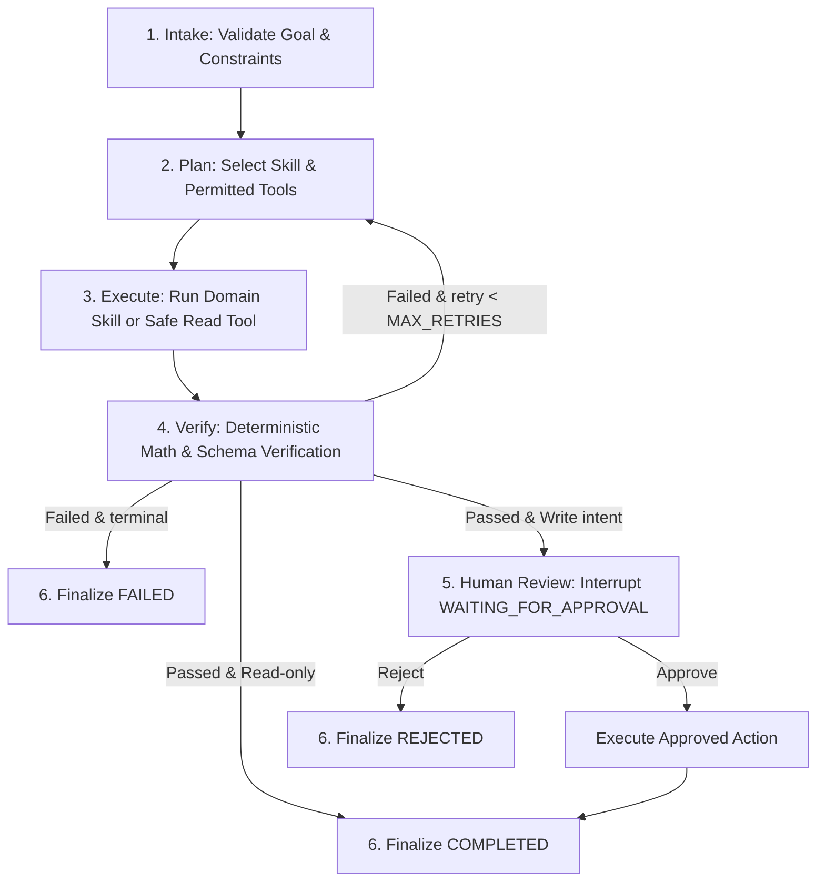

# ExamOps Agent — Intelligent Orchestration Layer

Dịch vụ AI Agent điều phối thông minh cho Hệ thống Thi Trực Tuyến (**Exam Platform**), xây dựng bằng **Python 3.11+**, **FastAPI**, **LangGraph**, và **Pydantic v2**. 

Dự án áp dụng kiến trúc phân tầng sạch (**Clean Layered Architecture**) kết hợp khung quản trị kỹ thuật chuẩn công nghiệp (**BMAD & Production AI Agent Template**).

---

## 🎯 1. Vai Trò & Ranh Giới Kiến Trúc

- **Lớp Điều Phối Thông Minh (Intelligent Orchestration Layer)**: ExamOps Agent không thay thế backend Laravel. Mọi dữ liệu chân lý (**System of Record - SoR**) như đề thi, ngân hàng câu hỏi, ca thi và điểm số thuộc quyền quản lý độc quyền của `core-api/` (Laravel 13 & PostgreSQL 16).
- **Ranh giới dữ liệu (Strict Boundary)**:
  ```text
  User / Teacher / Admin
            ↓
    FastAPI ExamOps (agentic-system)
            ↓
    StateGraph (6-step deterministic loop)
            ↓
    Skills & Tools Registry (Allowlist)
            ↓
    ExamPlatformClient (HTTPX, typed contracts)
            ↓ [RESTful API /api/v1]
    Laravel Core API (PostgreSQL 16)
  ```
- **Nguyên tắc an toàn (Fail-Closed & Zero-Leakage)**:
  - Agent **tuyệt đối không đọc trực tiếp** database PostgreSQL của Exam Platform.
  - Checkpoint lưu trữ độc lập tại SQLite riêng (`data/checkpoints.db`).
  - Mọi thao tác Ghi (`requires_write = True`) bắt buộc phải dừng lại ở cổng duyệt **Human-in-the-Loop** (`WAITING_FOR_APPROVAL`).
  - Tuyệt đối không log hoặc lưu trữ token, secret hay đáp án đúng (`correct_answer`).

---

## 🏗️ 2. Chu Trình Điều Phối 6 Bước (Deterministic Agent Loop)



1. **Intake (`nodes/intake.py`)**: Phân tích cú pháp, trích xuất `AgentGoal`, kiểm tra quyền của `actor`.
2. **Plan (`nodes/plan.py`)**: Xác định kỹ năng miền (`exam-blueprint` hoặc `exam-readiness-review`) và danh mục công cụ cho phép.
3. **Execute (`nodes/execute.py`)**: Thực thi tác vụ nguyên tử hoặc truy vấn dữ liệu từ API.
4. **Verify (`nodes/verify.py`)**: Thẩm định toán học (tổng tỷ lệ % = 100%, số câu nguyên dương, deduplication, status approved).
5. **Human Review (`nodes/approval.py`)**: Cổng ngắt (`interrupt`) tự động khi có đề xuất ghi dữ liệu hoặc tác động phòng thi.
6. **Finalize (`nodes/finalize.py`)**: Đóng gói `FinalResult` kèm bằng chứng xác thực (`VerificationResult`) và cập nhật trạng thái terminal.

---

## 📂 3. Cấu Trúc Phân Lớp Đã Tái Cấu Trúc (Refactored Directory Layout)

```text
agentic-system/
├── ARCHITECTURE.md             # Tài liệu thiết kế hệ thống chi tiết & sơ đồ Mermaid
├── JOURNAL.md                  # Nhật ký kỹ thuật và học tập hàng tuần
├── WORKLOG.md                  # Bảng phân công tác vụ và theo dõi tiến độ
├── SECURITY.md                 # Chính sách an toàn & quy trình ứng phó lộ khóa
├── Makefile                    # Phím tắt tự động hóa: run, test, eval, lint, format
├── pyproject.toml              # Cấu hình dự án Python & dependencies
├── .env.example                # Biến môi trường mẫu
├── .gitignore                  # Cấu hình bỏ qua venv, cache, checkpoints
├── data/                       # Thư mục lưu trữ SQLite checkpoints cục bộ
├── src/examops/                # Mã nguồn chính phân lớp chuẩn công nghiệp
│   ├── api/                    # Tầng giao tiếp REST API
│   │   ├── __init__.py
│   │   └── routes.py           # Endpoints: /tasks, /tasks/{id}, /resume, /health
│   ├── nodes/                  # 6 Nodes điều phối của LangGraph StateGraph
│   │   ├── __init__.py
│   │   ├── intake.py           # Node 1: Intake & Actor validation
│   │   ├── plan.py             # Node 2: Planning & tool allowlisting
│   │   ├── execute.py          # Node 3: Skill & platform execution
│   │   ├── verify.py           # Node 4: Math & Bloom verification
│   │   ├── approval.py         # Node 5a & 5b: Human-in-the-Loop Gate
│   │   └── finalize.py         # Node 6: Finalize terminal state
│   ├── tools/                  # Tầng công cụ (Least-Privilege Tool Registry)
│   │   ├── __init__.py
│   │   ├── contracts.py        # ToolContract & RegisteredTool wrapper
│   │   └── registry.py         # Registry thực thi chính sách đặc quyền tối thiểu
│   ├── services/               # Tầng dịch vụ hạ tầng
│   │   ├── __init__.py
│   │   ├── llm.py              # LLM Model Provider factory (Mock, Gemini, OpenAI)
│   │   └── platform.py         # ExamPlatformClient (HTTPX client)
│   ├── models/                 # Tầng dữ liệu & Pydantic Schemas
│   │   ├── __init__.py
│   │   └── schemas.py          # DTOs, Blueprints, ReadinessReview models
│   ├── config.py               # Cấu hình Pydantic Settings
│   ├── graph.py                # StateGraph assembler & compiler
│   ├── main.py                 # FastAPI application root & middleware
│   ├── model.py                # Model Provider protocol & adapters
│   ├── permissions.py          # Ma trận quyền hạn Actor RBAC
│   ├── persistence.py          # Quản lý SQLite Checkpointer
│   ├── platform_client.py      # HTTPX client kết nối core-api
│   ├── schemas.py              # Schema gốc
│   ├── skills.py               # Kỹ năng miền (Blueprint & Readiness Review)
│   ├── state.py                # AgentState schema
│   ├── telemetry.py            # OpenTelemetry & Structured Audit Log
│   └── verification.py         # Engine thẩm định toán học tất định
├── tests/                      # Bộ kiểm thử tự động
│   ├── conftest.py             # Fixtures dùng chung
│   ├── unit/                   # Kiểm thử đơn vị (Schemas, Skills, Verification, Tools)
│   ├── integration/            # Kiểm thử tích hợp (API, Graph flow, Persistence)
│   └── evals/                  # Bộ lượng giá 8 kịch bản nghiệp vụ khảo thí
├── docs/                       # Tài liệu kỹ thuật dự án
│   ├── 01-ARCHITECTURE.md
│   ├── 02-AGENT-LOOP.md
│   ├── 03-TOOL-AND-SKILL-CONTRACTS.md
│   ├── 04-SECURITY-AND-VERIFICATION.md
│   └── guide/                  # Bộ Technical Guidebook 10 chương chuyên sâu
├── eval/                       # Báo cáo đánh giá định lượng chất lượng Agent
│   └── results/report.md
├── presentation/               # Slide deck & kịch bản demo trực tiếp
└── scripts/                    # Scripts tự động thiết lập môi trường
    ├── setup.sh                # Linux / macOS / WSL
    └── setup.ps1               # Windows PowerShell
```

---

## 🚀 4. Hướng Dẫn Vận Hành & Lệnh Makefile

### Khởi chạy môi trường ảo:
```bash
# Windows
.\scripts\setup.ps1

# Linux / macOS
chmod +x scripts/setup.sh && ./scripts/setup.sh
```

### Các lệnh tắt với `make`:
```bash
make run        # Khởi chạy server FastAPI tại http://localhost:8001
make test       # Chạy toàn bộ 36 tests tự động với pytest
make eval       # Chạy bộ lượng giá 8 kịch bản nghiệp vụ khảo thí
make lint       # Kiểm tra chuẩn mã nguồn với ruff
make format     # Tự động định dạng mã nguồn với ruff
make typecheck  # Kiểm tra kiểu nghiêm ngặt với mypy (Level Strict)
make check      # Chạy chuỗi lint + typecheck + test
make clean      # Dọn dẹp cache và tệp tạm
```

---

## 🧪 5. Kết Quả Kiểm Thử & Lượng Giá

- **Độ phủ test**: **36/36 tests PASS 100%** trong **0.35 giây**.
- **Phân tích tĩnh**: **Mypy Strict PASS** trên toàn bộ 30 source files (0 lỗi).
- **Chuẩn mã nguồn**: **Ruff Clean** trên toàn bộ 46 files.
