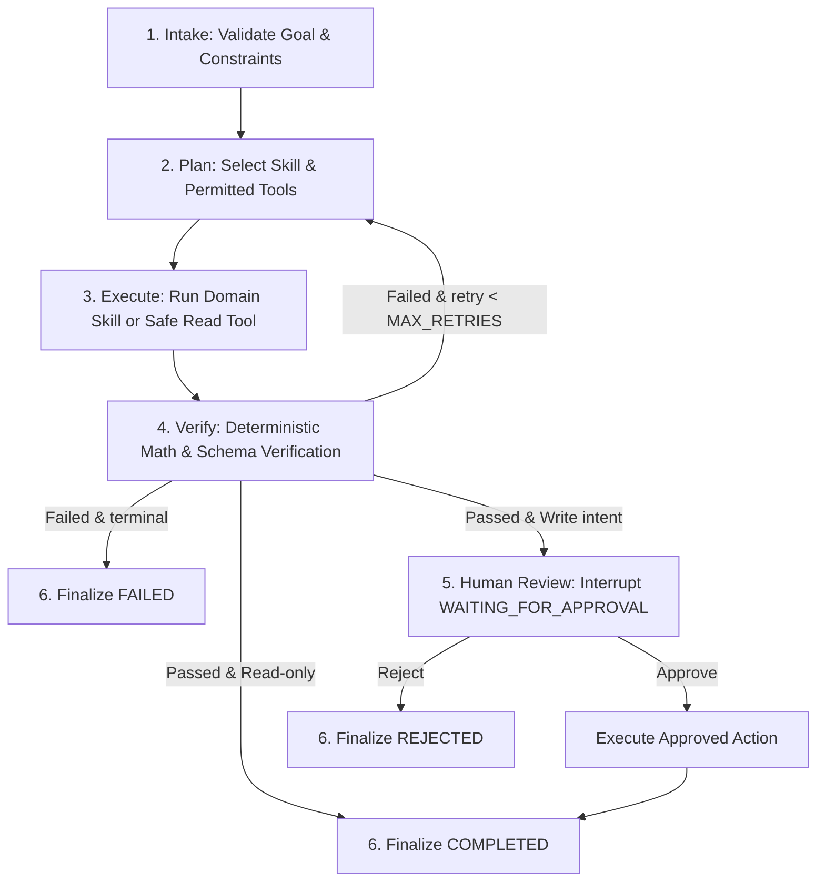

# 🤖 ExamOps Agent — Intelligent Orchestration Layer

> Intelligent AI Orchestration Service for the **Exam Platform / ThiSmart** online assessment system, engineered with **Python 3.11+**, **FastAPI**, **LangGraph**, and **Pydantic v2**.

The system adheres to **Clean Layered Architecture** combined with industrial AI governance standards (**BMAD & Production AI Agent Template**).

---

## 🎯 1. Architectural Boundaries & Principles

- **Intelligent Orchestration Layer**: ExamOps Agent does not replace the Laravel backend. All truth data (**System of Record - SoR**) including questions, exams, sessions, and attempts remain under the exclusive ownership of `core-api/` (Laravel 13 & PostgreSQL 16).
- **Strict Data Boundary**:
  ```text
  User / Teacher / Admin
            ↓
    FastAPI ExamOps (agentic-system)
            ↓
    LangGraph StateGraph (6-step deterministic loop)
            ↓
    Skills & Tools Registry (Allowlist)
            ↓
    ExamPlatformClient (HTTPX, typed contracts)
            ↓ [RESTful API /api/v1]
    Laravel Core API (PostgreSQL 16)
  ```
- **Fail-Closed & Zero-Leakage Policy**:
  - The Agent **never accesses** the PostgreSQL database directly.
  - State checkpoints are persisted independently in SQLite (`data/checkpoints.db`).
  - All write operations (`requires_write = True`) are blocked at the **Human-in-the-Loop Approval Gate** (`WAITING_FOR_APPROVAL`).
  - Zero-Leakage: Auth tokens, secrets, and `correct_answer` values are never logged, leaked, or cached.

---

## 🏗️ 2. 6-Step Deterministic Agent Loop



1. **Intake (`nodes/intake.py`)**: Parse user input, extract `AgentGoal`, validate `actor` permissions.
2. **Plan (`nodes/plan.py`)**: Select domain skill (`exam-blueprint` or `exam-readiness-review`) and build permitted tools allowlist.
3. **Execute (`nodes/execute.py`)**: Execute atomic domain skill or query Core API via read-only tools.
4. **Verify (`nodes/verify.py`)**: Deterministic verification (sum % = 100, positive integers, deduplication, valid topic distribution).
5. **Human Review (`nodes/approval.py`)**: StateGraph interrupt gate for write proposals.
6. **Finalize (`nodes/finalize.py`)**: Package `FinalResult` with `VerificationResult` and transition to terminal status.

---

## 📂 3. Directory Layout (Layered Architecture)

```text
agentic-system/
├── ARCHITECTURE.md             # System Design & Mermaid Sequence Diagrams
├── JOURNAL.md                  # Engineering Journal & Weekly Logs
├── WORKLOG.md                  # Task Allocations & Milestone Tracking
├── SECURITY.md                 # Security Policy & Secret Leak Incident Runbook
├── Makefile                    # Developer Automation Shortcuts (run, test, eval, lint, format)
├── pyproject.toml              # Python Dependencies & Packaging Configuration
├── .env.example                # Sample Environment Variables
├── .gitignore                  # Git Ignore Rules
├── data/                       # Local SQLite Checkpoints Directory
├── src/examops/                # Production Modular Source Code
│   ├── api/                    # REST API Communication Layer (FastAPI routes)
│   ├── nodes/                  # 6 Deterministic StateGraph Nodes (intake, plan, execute, verify, approval, finalize)
│   ├── tools/                  # Least-Privilege Tool Registry & Typed Contracts
│   ├── config.py               # Pydantic BaseSettings Configuration
│   ├── graph.py                # LangGraph StateGraph Assembler & Compiler
│   ├── main.py                 # FastAPI Application Root & Middleware
│   ├── model.py                # ModelProvider Factory (Mock, Gemini, OpenAI)
│   ├── permissions.py          # Actor RBAC Authorization Matrix
│   ├── persistence.py          # SQLite Checkpointer Engine
│   ├── platform_client.py      # HTTPX REST Client communicating with Core API
│   ├── schemas.py              # Domain Schemas & Pydantic DTOs
│   ├── skills.py               # Domain Skills (Blueprint & Readiness Review)
│   ├── state.py                # AgentState Typed Schema
│   ├── telemetry.py            # Structured Audit Logging & OpenTelemetry Instrumentation
│   └── verification.py         # Deterministic Math Verification Engine
├── tests/                      # Automated Test Suites
│   ├── conftest.py             # Shared Pytest Fixtures
│   ├── unit/                   # Unit Tests (Schemas, Skills, Verification, Tools)
│   ├── integration/            # Integration Tests (API, Graph flow, Persistence)
│   └── evals/                  # 8 Scenario Evaluation Benchmark Suite
├── docs/                       # Technical Documentation & 10-Chapter Technical Guidebook
├── eval/                       # Quantitative Agent Evaluation Reports
└── scripts/                    # Automated Setup Scripts (PowerShell & Bash)
```

---

## 🚀 4. Makefile Automation Commands

```bash
make run        # Start FastAPI server at http://localhost:8001
make test       # Run all 36 automated tests via pytest
make eval       # Run 8 pedagogical evaluation benchmark scenarios
make lint       # Code style & quality check with ruff
make format     # Auto-format codebase with ruff
make typecheck  # Strict static type checking with mypy (--strict)
make check      # Combined quality gate (lint + typecheck + test)
make clean      # Clean Python caches and temp files
```

---

## 🧪 5. Testing & Quality Verification Results

- **Test Suite**: **36/36 tests PASS 100%** in **0.35 seconds**.
- **Static Analysis**: **Mypy Strict PASS** across all 30 source files (0 errors).
- **Code Standards**: **Ruff Clean** across all 46 files.
