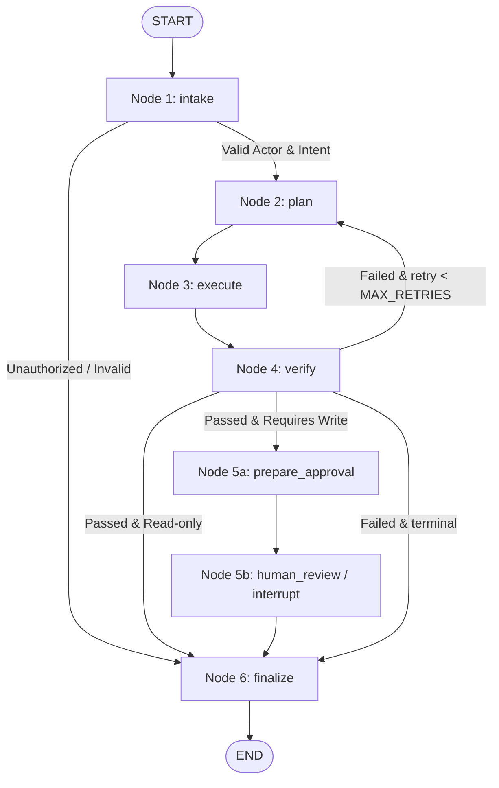

# ExamOps Agent — The 6-Node Deterministic Loop

## 1. Workflow State Machine

The Agent Loop is implemented as a compiled LangGraph `StateGraph` driven by `AgentState`:

## 2. Node Responsibilities

1. **Intake (`node_intake`)**:
   - Parses caller's prompt and validates `ActorContext`.
   - Extracts structured `AgentGoal`.
   - Rejects unauthorized actors before reasoning starts.
2. **Plan (`node_plan`)**:
   - Determines the target domain skill (`exam-blueprint` or `exam-readiness-review`).
   - Filters candidate tools against actor's allowlisted permissions.
3. **Execute (`node_execute`)**:
   - Runs domain skill calculation or reads Core API data using `ExamPlatformClient`.
4. **Verify (`node_verify`)**:
   - Enforces mathematical integrity (e.g. difficulty sum == 100%, question counts > 0).
   - Enforces deduplication and question status (`ready`).
5. **Human Review Gate (`node_prepare_approval` + `node_human_review`)**:
   - Generates an immutable `ApprovalProposal` with SHA-256 argument hash.
   - Saves proposal to checkpoint and calls LangGraph `interrupt()`.
   - Resumes only when an authorized teacher/admin sends `POST /api/v1/tasks/{thread_id}/resume`.
6. **Finalize (`node_finalize`)**:
   - Compiles `FinalResult` with terminal status (`COMPLETED`, `FAILED`, `REJECTED`, or `WAITING_FOR_APPROVAL`).
   - Logs `TASK_TERMINATED` structured audit event.
