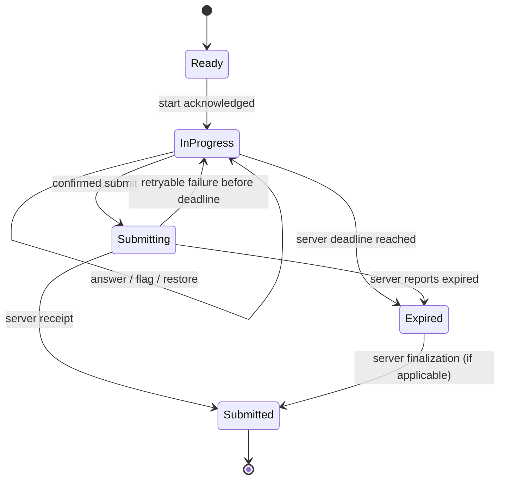

# 17 — Kiến Trúc Web Client & Trải Nghiệm Người Dùng (Frontend Architecture & UI/UX Design)

**Dự án:** ThiSmart (Exam Platform)  
**Tài liệu:** `docs/05-frontend/17-FRONTEND_DESIGN.md`  
**Stack:** Next.js App Router (15+), React 19, TypeScript strict, Tailwind CSS, TanStack Query v5, React Hook Form, Zod, Lucide React  
**Thương hiệu & Bản sắc:** **ThiSmart Concept 03 — Minimal Tech / Modern EdTech** (Chi tiết: [`THISMART_BRAND_GUIDELINES.md`](THISMART_BRAND_GUIDELINES.md))  
**Slogan:** *Thi thông minh. Đánh giá chính xác.*  
**Trạng thái:** Approved Architecture Baseline  
**Mục tiêu:** Giao diện tối giản, thanh lịch, tin cậy tuyệt đối, an toàn thi cử và phòng chống gian lận.

---

## 0. Executive decisions

1. **Hai lớp giao diện riêng biệt:** Workspace Shell cho Admin/Teacher/Student dashboard; Focus Exam Shell cho `/exam/[attemptId]` không sidebar, không menu điều hướng ra ngoài.
2. **Độ tin cậy quan trọng hơn animation:** Đồng hồ lấy `deadlineAt` từ backend; biểu thị rõ `saving/saved/offline/failed`; có quy trình nộp bài và xử lý hết giờ riêng.
3. **Accessibility by default:** WCAG 2.2 AA làm mục tiêu; ưu tiên semantic HTML, keyboard, focus, contrast, status message.
4. **Dữ liệu có nguồn chân lý:** server xác nhận đáp án, điểm số, thời hạn và trạng thái submit; client chỉ optimistic render.
5. **Proctoring là tín hiệu, không phải bằng chứng tuyệt đối:** sự kiện browser không đủ căn cứ tự động kết luận gian lận. Có chính sách minh bạch, chống spam và cơ chế review.
6. **Bản sắc thương hiệu ThiSmart đồng nhất:** Hệ thống mang tên chính thức **ThiSmart** (*Thi thông minh. Đánh giá chính xác.*) theo định hướng **Concept 03 — Minimal Tech / Modern EdTech**, sử dụng dải màu chuyển tiếp `#2563EB` $\rightarrow$ `#06B6D4`, logo chính thức tại `/brand/`, ưu tiên trải nghiệm dịu mắt và tập trung tuyệt đối trong phòng thi (Chi tiết: [`THISMART_BRAND_GUIDELINES.md`](THISMART_BRAND_GUIDELINES.md)).

### Phạm vi và nguyên tắc trải nghiệm

- Persona: Student (thi đúng giờ, không mất đáp án), Teacher/Proctor (tạo đề, giám sát nhanh), Admin (quản lý vận hành, audit).
- Ưu tiên P0: truy cập đúng ca thi, hiển thị câu hỏi đúng, lưu không mất dữ liệu, hết giờ chuẩn, nộp một lần, resume sau gián đoạn.
- Ưu tiên P1: thông báo có ngữ cảnh, bộ lọc, dashboard rõ ràng, responsive và keyboard-first.
- Không để màu sắc là tín hiệu duy nhất: trạng thái có icon + chữ + mô tả truy cập được.

---

## 1. Information Architecture / Route Tree

```text
app/
├── layout.tsx                         # HTML root, fonts, providers
├── page.tsx                           # redirect theo auth/role
├── (auth)/
│   ├── layout.tsx                     # auth-centered split screen
│   ├── login/page.tsx
│   ├── register/page.tsx               # tùy chính sách tự đăng ký
│   └── forgot-password/page.tsx
├── (workspace)/
│   ├── layout.tsx                     # sidebar + topbar + breadcrumb
│   ├── admin/
│   │   ├── page.tsx                   # overview
│   │   ├── users/page.tsx
│   │   ├── roles/page.tsx
│   │   ├── audit-logs/page.tsx
│   │   └── settings/page.tsx
│   ├── teacher/
│   │   ├── page.tsx                   # overview
│   │   ├── questions/page.tsx
│   │   ├── questions/new/page.tsx
│   │   ├── exams/page.tsx
│   │   ├── exams/[id]/edit/page.tsx
│   │   ├── sessions/page.tsx
│   │   ├── sessions/[id]/monitor/page.tsx
│   │   └── sessions/[id]/results/page.tsx
│   └── student/
│       ├── page.tsx                   # overview & next exam
│       ├── exams/page.tsx
│       ├── exams/[id]/instructions/page.tsx
│       ├── results/page.tsx
│       └── results/[attemptId]/page.tsx
├── (focus)/
│   └── exam/
│       └── [attemptId]/
│           ├── layout.tsx             # focus shell: exam-only
│           └── page.tsx
├── forbidden/page.tsx
├── not-found.tsx
├── error.tsx
└── global-error.tsx
```

Route groups `(auth)`, `(workspace)`, `(focus)` **không xuất hiện trong URL**. Layout làm nhiệm vụ dựng khung; authorization thật phải kiểm tra tại DAL/API, không chỉ dựa vào sidebar ẩn hay route guard frontend. `app/layout.tsx` là root duy nhất để tránh full reload giữa các nhóm layout.

### User journeys

- **Student:** Đăng nhập → ca thi được phân công → điều kiện dự thi/thiết bị/nội quy → bắt đầu attempt → làm bài → xem lại câu chưa trả lời → xác nhận nộp → biên nhận nộp → kết quả (khi được công bố).
- **Teacher:** Ngân hàng câu hỏi → tạo đề/mẫu → cấu hình ca thi → phân công → monitor realtime → đóng ca → thống kê/xuất kết quả.
- **Admin:** Dashboard → user/role → hệ thống/ca thi → audit log → xử lý sự cố.

---

## 2. Design system

### 2.1 Visual language

**Style:** Academic SaaS, clean enterprise, spacious, bright neutral surfaces, ít trang trí, có thứ bậc thị giác rõ ràng. Không dùng gradient/hình minh họa rối trong phòng thi.

| Semantic token | Light | Dark (dashboard optional) | Ý nghĩa |
|---|---|---|---|
| `background` | `#F8FAFC` | `#0B1220` | nền app (dịu mắt khi thi dài) |
| `surface` | `#FFFFFF` | `#172338` | card, panel, question box |
| `surface-subtle` | `#F1F5F9` | `#213149` | section, stat bar |
| `text-primary` | `#0F172A` | `#F8FAFC` | title/body chính (chuẩn AAA) |
| `text-secondary` | `#475569` | `#CBD5E1` | metadata, caption, nhãn phụ |
| `border` | `#E2E8F0` | `#334155` | đường kẻ divider, viền input |
| `primary` | `#2563EB` | `#60A5FA` | CTA chính, active navigation |
| `primary-hover` | `#1D4ED8` | `#3B82F6` | hover primary button |
| `primary-soft` | `#EFF6FF` | `#1E3A5F` | nền mục được chọn (selected) |
| `accent` | `#06B6D4` | `#22D3EE` | điểm nhấn công nghệ, tiến độ thi |
| `success` | `#15803D` | `#4ADE80` | đã xác nhận lưu (saved), nộp bài |
| `warning` | `#B45309` | `#FBBF24` | cảnh báo sắp hết giờ, đánh dấu xem lại |
| `danger` | `#B91C1C` | `#F87171` | mất kết nối, lỗi lưu, nộp khẩn cấp |
| `focus` | `#1D4ED8` | `#93C5FD` | vòng viền focus ring (a11y) |

> 🎨 **Brand Identity Specs:** Bộ nhận diện thương hiệu hoàn chỉnh, quy chuẩn kích thước logo, favicon và thành phần `BrandLogo` được quy định tại [`THISMART_BRAND_GUIDELINES.md`](THISMART_BRAND_GUIDELINES.md) (assets tĩnh tại `web-client/public/brand/`).

**Typography:** Geist hoặc Inter (hỗ trợ tiếng Việt 100%), size 14–16px body, line-height 1.5–1.65. Question body 16–18px, line-height 1.65. Headings 24–30px dashboard; 20–24px exam. Timers bắt buộc dùng `font-variant-numeric: tabular-nums`.

**Spacing:** 4px system: 4, 8, 12, 16, 20, 24, 32, 40. Card padding 24–32px desktop, 16–20px mobile. Container max-width 1440px. Radius button/input 8–10px, card 14–16px, modal 18–20px. Shadow nhẹ; border 1px mặc định.

**Motion:** transition 120–180ms cho hover/selection, không animate gây phân tâm; `prefers-reduced-motion: reduce` tắt animation không cần thiết. Tuyệt đối không dùng hiệu ứng nhấp nháy (flashing) khi countdown.

**Component library (đề xuất, không bắt buộc):** Tailwind + shadcn/ui/Radix cho Dialog, AlertDialog, Tooltip, Dropdown, Table + lucide-react cho icons. React Hook Form + Zod cho admin/teacher forms. Design tokens được khai báo một nơi tại `brand-tokens.css` hoặc `globals.css`.

### 2.2 UI component inventory

`AppSidebar`, `TopBar`, `Breadcrumbs`, `PageHeading`, `StatCard`, `DataTable`, `FilterBar`, `StatusChip`, `EmptyState`, `ErrorState`, `Skeleton`, `ConfirmDialog`, `Toast`, `FormField`, `Pagination`, `ExamHeader`, `ExamTimer`, `QuestionCard`, `OptionCard`, `QuestionNavigator`, `ExamProgress`, `AnswerSaveIndicator`, `SubmitExamDialog`, `ConnectionBanner`, `ProctoringNotice`.

**Variant nhất quán:** `default`, `hover`, `focus-visible`, `active`, `disabled`, `loading`, `error`, `success`.

---

## 3. Focus Exam Room — primary UX

### 3.1 Desktop: 1440px+

```text
┌──────────────────────────────────────────────────────────────────────────────┐
│ [Logo Mark] ThiSmart  | Lập trình Web - K21      Nguyễn Văn A · SV101        │
│                       45:12 còn lại  ·  ✓ Đã lưu tất cả thay đổi             │
├──────────────────────────────────────────────────────────────────────────────┤
│ Tiến độ 28 / 40 câu trả lời [████████████████░░░░░░] 70%                   │
├────────────────────────────────────────────────┬─────────────────────────────┤
│ QUESTION CARD                                  │ QUESTION NAVIGATOR          │
│ Câu 15 / 40            0,25 điểm    [⚑ Đánh dấu]│ Đã làm 28 · Chưa làm 12    │
│                                                │ [01][02][03][04][05]       │
│ Nội dung câu hỏi rõ ràng, dòng đủ rộng,        │ [06][07][08][09][10] ...   │
│ không quá dài, có khoảng trắng.                │ Legend + Review flag       │
│                                                │                             │
│ ( ) A. ...                                     │  ⚑ Cần xem lại: 3          │
│ (●) B. ...  [selected border & soft background] │                             │
│ ( ) C. ...                                     │ [ NỘP BÀI THI ]            │
│ ( ) D. ...                                     │                             │
│                                                │                             │
├────────────────────────────────────────────────┴─────────────────────────────┤
│ [ ← Câu trước ]   Lối tắt: ← → / 1-4             [ Câu tiếp theo → ]        │
└──────────────────────────────────────────────────────────────────────────────┘
```

**Exam header:** cố định (sticky) nhưng không ăn quá nhiều chiều cao; tên môn và định danh thí sinh, timer, trạng thái lưu. Tránh dùng timer neon và số đỏ liên tục.

**Main area:** 2 cột khoảng 70:30 hoặc `minmax(0, 1fr) 320px`, cách nhau 24px. Nội dung câu hỏi đặt ở card bên trái, không kéo dòng đọc quá dài. Bên phải question palette sticky phía dưới header, có thể scroll riêng khi nhiều câu.

**Navigator state:**

- `answered`: nền blue nhẹ, text/outline blue, thêm check hoặc nhãn hỗ trợ.
- `unanswered`: nền trắng, border xám.
- `current`: ring blue 2px nổi bật kể cả answered.
- `flagged`: icon cờ nhỏ góc trên hoặc chấm cam, **không ghi đè** trạng thái answered.
- `pending-save`: chỉ hiển thị ở answer state/status, không diễn giải answered là đã đồng bộ.

**Question UX:** tương tác toàn bộ OptionCard, vẫn dùng `<input type="radio">` thật và `<fieldset>/<legend>`; chọn xong thấy selected ngay, song chỉ hiện “Đã lưu” khi backend ACK. Dùng `button` riêng cho đánh dấu câu xem lại. Không nhầm giữa đánh dấu xem lại và chọn đáp án.

**Footer:** nút Trước/Tiếp theo cân xứng, trạng thái progress rõ; không đặt primary Submit ngay cạnh Next mà không xác nhận. Nút nộp ở panel + modal 2 bước. Keyboard shortcuts chỉ kích hoạt khi không focus vào ô nhập, không xung đột screen reader.

### 3.2 Tablet & Mobile

- ≥1280px: panel điều hướng phải 300–340px, sticky.
- 768–1279px: main rộng + navigator thu gọn dạng drawer (nút “Danh sách câu hỏi”).
- <768px: một cột, header rút gọn vẫn có timer + save state; bottom sticky bar có Previous / Navigator / Next. Option card đủ cao ≥44px, dòng chữ không bị tràn.
- Chính sách thi trên mobile phải được xác định tại nghiệp vụ (cho phép hay không). Nếu không cho phép, hiển thị preflight blocker **trước khi bắt đầu**, không đưa vào phòng thi rồi mới từ chối.

### 3.3 Before / During / After exam

**Preflight `/student/exams/[id]/instructions`:** Môn học, duration, giờ mở/đóng ca (múi giờ), số câu, chính sách thi, kiểm tra kết nối, điều kiện thiết bị, nội quy, cách xử lý mất mạng. Bắt đầu thi chỉ khi backend cấp `attemptId` hợp lệ và `deadlineAt`.

**During:** current question, answered count, flagged count, timer, save state, offline banner, accessibility controls (font size nếu chính sách cho phép). Timer 10m / 5m / 1m cảnh báo nhẹ một lần, không popup chặn thao tác.

**Review & Submit:** khi nộp hiển thị “Đã trả lời 28/40; chưa trả lời 12; đánh dấu 3” và checkbox/confirm CTA. Nếu còn pending writes, chờ đồng bộ hoặc cảnh báo rõ và có chính sách xử lý; tuyệt đối không xác nhận thành công giả. Khi server ACK submit, chuyển đến `/student/results/[attemptId]` hoặc màn hình receipt (không giả định điểm được xem ngay).

**Deadline:** UI tự chuyển `submitting/expired` khi thời hạn qua, server quyết định trạng thái cuối và từ chối writes quá hạn. Reload/resume từ trạng thái server.

---

## 4. Student Workspace

**Dashboard:** Hero “Bài thi sắp diễn ra” với CTA “Xem hướng dẫn”, next upcoming exam, ongoing attempts, total completed, notices. Không dùng card KPI vô nghĩa.

**Exams list:** Tabs `Sắp diễn ra`, `Đang mở`, `Đã kết thúc`; mỗi session card cho biết course, giáo viên, start/end, duration, trạng thái, CTA `Xem chi tiết` / `Tiếp tục thi` / `Xem kết quả` tùy backend.

**Results:** filters theo môn/kỳ, score khi đã công bố, pass/fail theo quy chế, time submitted, exam details nếu được phép. Never display `correctAnswer` or grading rubric trước `release_at`.

---

## 5. Teacher Workspace

**Questions:** DataTable search + filter theo môn, loại câu, difficulty, trạng thái; preview question, enable/disable, draft/published. Phân biệt “bật/tắt câu hỏi” với “ẩn lịch sử”. Bulk actions cần confirmation. Question editor preview bên cạnh form, Zod validation.

**Exams:** exam template builder, danh sách câu, điểm từng câu và tổng điểm, randomization policy, estimated duration; cảnh báo đề vô hiệu (0 câu, câu không có đáp án đúng, multi-select được khai báo single-select). Cần lưu snapshot cấu hình sau publish.

**Sessions:** cấu hình cửa sổ thi, phân công sinh viên, quy tắc retake, lịch công bố điểm. Overview card cho phép drill-down.

**Live monitor:** KPI hàng đầu `Được gán / Đã vào / Đang thi / Đã nộp / Mất kết nối`; bảng thí sinh có họ tên, mã SV, tiến độ, thời gian còn lại (theo deadline), kết nối cuối, số cảnh báo (không đồng nhất với gian lận), trạng thái. Real-time dùng SSE/WebSocket hoặc polling có điều kiện; hiển thị `Cập nhật lần cuối`, stale banner khi mất realtime. Events panel có filter, review trail, không auto-sanction chỉ vì `blur/tab_hidden`.

**Results:** filters, basic distribution chart, average/median, export có kiểm soát vai trò, access audit.

---

## 6. Admin Workspace

- Dashboard: active exam sessions, online attempts, failed autosaves, API latency/error-rate nếu có monitoring, recent actions.
- Users: DataTable, filters roles/status, invite/create, suspend/reactivate, audit changes.
- Roles: RBAC matrix và permission descriptions; mọi mutation kiểm tra quyền tại API.
- Audit Logs: timestamp server, actor, target, action, result, correlation ID; có phân trang và filter. Audit bất biến hoặc append-only theo chính sách backend.
- Settings: examination defaults, privacy retention, notification templates, accessibility and network policies.

---

## 7. Frontend architecture & state model

### 7.1 State ownership

| Nhóm | Nguồn chân lý | Kỹ thuật |
|---|---|---|
| Auth, role, authorization | server/session | Server Components + DAL/API |
| Questions, attempts, sessions, results | API | TanStack Query v5 |
| Teacher/admin forms | form đang chỉnh | React Hook Form + Zod |
| Current question, drawer, dialog | client ephemeral | useState/useReducer |
| Answers optimistic | client draft vs server ack | mutation + per-question revision |
| Timer | server `deadlineAt` + `serverNow` | client display from corrected clock |
| Proctoring signals | server event stream | batched and deduped events |

**Không dùng React Query thay thế mọi loại state.** Không lưu secrets, answer keys, access tokens trong localStorage. Không coi browser clock là nguồn thời gian đáng tin cậy.

### 7.2 Backend DTO mẫu

```ts
type SaveState = 'idle' | 'saving' | 'saved' | 'offline' | 'error';
type AttemptStatus = 'ready' | 'in_progress' | 'submitting' | 'submitted' | 'expired';

type ExamAttemptDto = {
  id: string;
  status: AttemptStatus;
  serverNow: string;           // time sync at response
  deadlineAt: string;          // server-enforced, UTC ISO 8601
  revision: number;
  questions: Array<{
    id: string;
    order: number;
    type: 'single_choice' | 'multiple_choice';
    statement: string;
    points: number;
    options: Array<{ id: string; label: string; text: string }>;
    selectedOptionIds: string[];
    flagged: boolean;
  }>;
};
```

**Security:** no `correctOptionIds`, grading metadata, hidden exam bank, private teacher notes in student response. API verifies attempt ownership, session window, status, question belonging to snapshot.

### 7.3 Reliable autosave protocol

```text
User selects option
  ├─ Immediate: update draft UI, status = "Đang lưu…"
  ├─ Enqueue command {attemptId, questionId, selectedOptionIds,
  │                    clientSeq, idempotencyKey}
  ├─ Send authenticated PATCH (serialized by question or attempt)
  │   ├─ 2xx + ack seq/revision → status = "Đã lưu" if ACK matches latest draft
  │   ├─ Network failure → status = "Chưa đồng bộ" + retry/backoff
  │   ├─ 409 stale revision → reconcile authoritative snapshot
  │   └─ 401/403/410/expired → stop retry, show actionable state
  └─ On submit: drain writes → POST submit idempotently → server receipt
```

**Ràng buộc:** React Query `useMutation` mặc định có thể chạy song song; dùng `scope.id` để serialize hoặc explicit queue, đồng thời backend chặn stale request bằng sequence/revision. Một request thành công cũ không được làm badge thành “Đã lưu” khi draft mới vẫn pending. Retry giới hạn với exponential backoff và jitter. Offline queue có thể chỉ trong memory (mất khi reload); nếu sản phẩm yêu cầu tồn tại qua reload, thiết kế persistence được review bảo mật riêng và có TTL/mã hóa thích hợp. Không hứa chắc chắn lưu được trong trạng thái offline.

**Invalidation:** Sau submit thành công, invalidate `['student','sessions']`, `['student','results']`, `['attempt', id]` phù hợp; không refetch answer key. Chỉ invalidate sau server ack, không khi optimistic chọn đáp án.

### 7.4 Timer

- `remainingMs = max(0, deadlineAt - estimatedServerNow)`, hiệu chỉnh offset bằng `serverNow` và round-trip estimate. Dùng `performance.now()` cho thời gian trôi trong phiên hiện tại; cập nhật lại khi visibility trở lại và theo periodic sync.
- Không tự động cộng lại thời gian khi mất mạng; backend deadline là thẩm quyền. Client timeout gọi status/submit flow nhưng không tự ghi “Đã nộp”.
- Giảm layout shift bằng tabular numbers. Hỗ trợ assistive tech: không `aria-live` đọc mỗi giây; thông báo khi tới các mốc có ý nghĩa.

### 7.5 Attempt state machine



UI derived from backend state. Disable choice interactions in `submitted`, `expired`, and while server is finalizing according to business rules.

---

## 8. Proctoring: UX + technical guardrails

### 8.1 Events

- `tab_hidden` — `document.visibilityState === 'hidden'`.
- `window_blur` — window loses focus (can occur from benign OS interactions).
- `fullscreen_exit` — only after exam entered fullscreen and only if browser supports API.
- `connection_lost` / `connection_restored` — network-level indicators, not proof of cheating.

### 8.2 Policy

1. Preflight explains what is collected, purposes, retention and appeals/contact.
2. De-duplicate near-simultaneous events (`blur` + `hidden`) within a short window; avoid event storms on OS notifications.
3. Batch/throttle events; server assigns `received_at`; client time is only contextual.
4. Critical life-cycle event may use `sendBeacon()` or `fetch(..., {keepalive:true})` as best-effort; delivery is **not guaranteed**.
5. Do not rely on fullscreen as mandatory enforcement across all browsers/platforms without capability checks; `requestFullscreen()` requires user gesture where supported.
6. Do not auto-submit/auto-fail solely on client signals. Authorized teacher review needed before consequences.
7. Explicit data minimization and retention policy; avoid webcam/screen capture unless separately authorized and legally/operationally specified.

### 8.3 Hook API (proposal)

```ts
useExamProctoring({
  attemptId,
  enabled: attemptStatus === 'in_progress',
  fullscreenWasEntered,
  onEventQueue: enqueueProctoringEvent,
});
```

Hook responsibility: attach/remove listeners, dedupe, dispatch minimal events. `enqueueProctoringEvent` should implement buffering, retry, session/auth checks and server contract separately. Keep callbacks stable to avoid listener churn.

---

## 9. UX status copy

| Trạng thái | Copy UI | CTA |
|---|---|---|
| initial | “Sẵn sàng làm bài” | none |
| saving | “Đang lưu câu trả lời…” | none |
| saved | “Đã lưu tất cả thay đổi” | none |
| offline | “Mất kết nối — câu trả lời mới chưa được đồng bộ.” | “Thử kết nối lại” |
| retrying | “Đang thử lưu lại…” | none |
| conflict | “Đáp án đã thay đổi ở phiên khác. Vui lòng kiểm tra.” | “Tải trạng thái mới” |
| deadline warning | “Còn 5 phút. Hãy kiểm tra các câu chưa trả lời.” | “Xem câu chưa làm” |
| submitting | “Đang gửi bài thi…” | disabled actions |
| submitted | “Đã nộp bài thành công” + receipt ID/time | “Trở về trang cá nhân” |
| expired | “Thời gian làm bài đã kết thúc. Đang xác nhận bài thi.” | none |

Tất cả status thay đổi cần `role="status"`/`aria-live="polite"` đúng ngữ cảnh; lỗi cần `role="alert"` khi thật sự khẩn cấp. Tránh toast mỗi lần lưu đáp án, nên cập nhật save chip yên tĩnh.

---

## 10. Accessibility & responsive acceptance criteria

- Thiết kế hướng tới WCAG 2.2 AA: contrast text thường ≥4.5:1, large text ≥3:1, non-text controls ≥3:1, keyboard focus visible.
- Câu hỏi được đọc qua `fieldset` + `legend`; label click được; radio/checkbox có semantic đúng loại câu.
- Khi chuyển câu, focus chuyển hợp lý tới heading câu mới (không cưỡng chế nếu screen reader user đang thao tác theo phương thức khác).
- Có skip link tới nội dung chính trong dashboard, modal trap focus đúng và trả focus về trigger.
- Keyboard fully operable; desktop option card minimum interactive height 44px để thoải mái dùng; responsive tại 360, 390, 768, 1024, 1440px; zoom 200% không mất chức năng trọng yếu.
- Buttons có disabled explanation, loading progress và tap targets phù hợp.
- Reduced motion, không âm thanh bắt buộc; đảm bảo local timezone hiển thị rõ ở màn hình ca thi.

---

## 11. Suggested code structure

```text
src/
├── app/
├── components/
│   ├── ui/                        # primitives
│   ├── layout/                    # AppSidebar, TopBar, PageShell
│   ├── data-display/              # DataTable, StatusChip, EmptyState
│   └── exam/                      # ExamHeader, QuestionCard, Navigator...
├── features/
│   ├── auth/
│   ├── exam-taking/
│   │   ├── api/                    # DTO, query keys, mutations
│   │   ├── hooks/                  # useExamTimer, useExamProctoring
│   │   ├── state/                  # ephemeral exam reducer
│   │   └── components/
│   ├── exam-authoring/
│   ├── session-monitoring/
│   ├── question-bank/
│   └── admin-users/
├── lib/
│   ├── api-client.ts              # error normalization, auth
│   ├── query-client.ts
│   ├── auth.ts
│   └── date-time.ts
├── schemas/                       # zod contracts
└── styles/                        # tokens / globals
```

**App Router guidance:** Render static/page shells as Server Components by default; interactive exam room, timers, selection controls as narrowly scoped Client Components. Put QueryClientProvider in a client provider component. Server-side role checks live near data access, not only in layout.

---

## 12. Definition of Done — production UX

### Functional acceptance

- [ ] Student can start/resume only an authorized active attempt.
- [ ] All answer changes show immediate local selection and an accurate backend-ack save state.
- [ ] Rapid A→B→C selection cannot persist stale A or B over latest C.
- [ ] Offline/timeout/HTTP 401/403/409/5xx behavior is distinct and recoverable where possible.
- [ ] Timer matches server-enforced deadline within approved tolerance; tab sleep/reload does not extend time.
- [ ] Submit is idempotent; double clicks and refresh do not duplicate submissions.
- [ ] Results and answer keys respect release policy.
- [ ] Monitor clearly labels stale data, never silently portrays old data as realtime.
- [ ] Proctoring logs are rate-limited, auditable, transparently described; not treated as conclusive cheating evidence.

### Visual/a11y acceptance

- [ ] 360/390/768/1024/1440px viewport checks pass; no critical overflow.
- [ ] All question interactions pass keyboard-only test.
- [ ] Automated axe checks plus manual WCAG audit on exam route.
- [ ] Contrast checked on every functional text/control state.
- [ ] Screen reader smoke test for question, options, timer warning, save status, confirm dialog.
- [ ] High latency (3G), airplane mode, simultaneous answer changes, visibility changes, and forced browser refresh tested.

### Delivery phases

- **Phase 1 / P0:** tokens + shells + focus exam + autosave + deadline/submit + a11y + backend contract.
- **Phase 2 / P1:** teacher authoring, sessions, live monitor, results, admin.
- **Phase 3 / P2:** analytics enrichments, preferences, optional dark dashboard, advanced keyboard shortcuts.

---

## 13. Source references & tài liệu liên quan

### Official Technical References
- Next.js Route Groups: https://nextjs.org/docs/app/api-reference/file-conventions/route-groups
- Next.js Auth/Authorization: https://nextjs.org/docs/app/guides/authentication
- TanStack Query Optimistic Updates: https://tanstack.com/query/latest/docs/framework/react/guides/optimistic-updates
- TanStack Query Mutation Scopes: https://tanstack.com/query/latest/docs/framework/react/guides/mutations
- TanStack Query Network Mode: https://tanstack.com/query/latest/docs/framework/react/guides/network-mode
- MDN `visibilitychange`: https://developer.mozilla.org/en-US/docs/Web/API/Document/visibilitychange_event
- MDN `sendBeacon`: https://developer.mozilla.org/en-US/docs/Web/API/Navigator/sendBeacon
- WCAG 2.2 Focus Visible: https://www.w3.org/WAI/WCAG22/Understanding/focus-visible

### Internal Project Cross-References
- [THISMART_BRAND_GUIDELINES.md](THISMART_BRAND_GUIDELINES.md): Cẩm nang nhận diện thương hiệu ThiSmart Concept 03 và bộ tài nguyên logo/favicon.
- [SCREEN_SPECIFICATIONS.md](SCREEN_SPECIFICATIONS.md): Danh mục và ma trận 17 màn hình toàn hệ thống ánh xạ CSDL & RESTful API `/api/v1`.
- [wireframe/](wireframe/): Hồ sơ wireframe chi tiết từng phân hệ (`01-AUTH`, `02-STUDENT`, `03-TEACHER`, `04-ADMIN`, `05-FOCUS-EXAM-ROOM-SPEC`).
- [12-API_DESIGN.md](../../03-architecture-api/12-API_DESIGN.md): Hợp đồng giao tiếp API RESTful Backend Laravel `/api/v1`.
- [09-DATABASE_DESIGN.md](../../02-domain-database/09-DATABASE_DESIGN.md): Thiết kế CSDL 13 bảng quan hệ PostgreSQL 16.
- [16-CONSISTENCY_AND_CONCURRENCY.md](../../04-security-concurrency/16-CONSISTENCY_AND_CONCURRENCY.md): Xử lý tranh chấp đồng thời, khóa bi quan nộp bài và Idempotency.

**Lưu ý:** Prototype HTML đi kèm (`wireframe/wireframe-preview.html` và `exam-platform-ui-preview.html`) mô phỏng UI và lưu đáp án cục bộ bằng JavaScript với độ trễ giả lập; không chứa backend, auth, tự động lưu thật, điểm thi thật hoặc chống gian lận thật. Không sử dụng prototype này làm phòng thi production khi chưa triển khai các contract và kiểm thử nêu trên.
