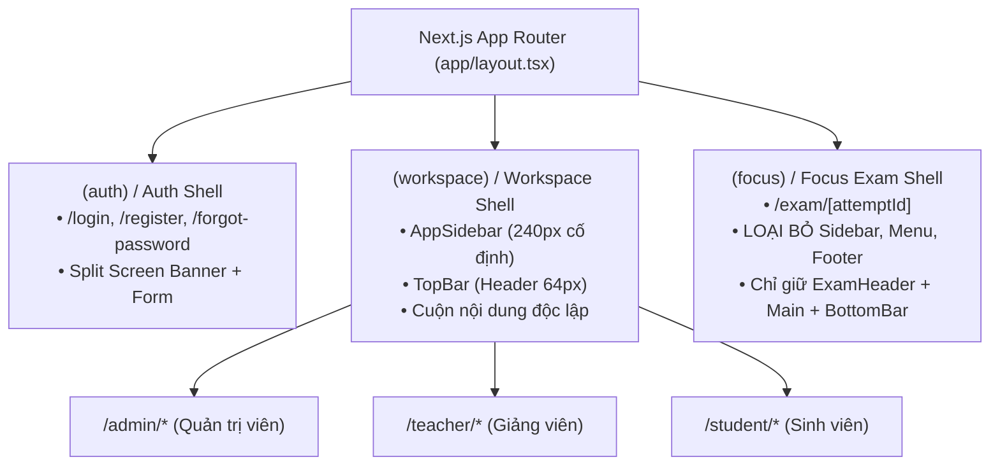

# 💻 05 — Nhóm Tài Liệu: Kiến Trúc Giao Diện & Web Client (ThiSmart Frontend Design)

> **Single Source of Truth** cho toàn bộ kiến trúc giao diện, hệ thống nhận diện thương hiệu, ma trận 17 màn hình, đặc tả phòng thi tập trung (Focus Exam Room) và quy chuẩn kỹ thuật cho ứng dụng Web Client (**`web-client/`**) của nền tảng **ThiSmart**.

---

## 🌟 1. Tổng Quan & Triết Lý Thiết Kế Sản Phẩm

Hệ thống khảo thí trực tuyến mang tên thương hiệu chính thức: **ThiSmart**  
- **Slogan:** `Thi thông minh. Đánh giá chính xác.`
- **Định hướng nhận diện:** **Concept 03 — Minimal Tech / Modern EdTech** (Chi tiết: [`THISMART_BRAND_GUIDELINES.md`](THISMART_BRAND_GUIDELINES.md)).
- **Công nghệ triển khai:** Next.js 15+ (App Router), React 19, TypeScript Strict Mode, Tailwind CSS, TanStack Query v5, React Hook Form, Zod, Lucide React.
- **Phong cách thị giác (Visual Style):** **Academic SaaS / Enterprise Clean** — Tinh giản, thanh lịch, khoảng trắng rộng rãi, dịu mắt cho thí sinh làm bài thi kéo dài. Không lạm dụng hiệu ứng neon hay gradient gây mất tập trung.
- **Quy tắc ưu tiên tối thượng:**
  $$\text{An toàn thi cử \& Nghiệp vụ Backend} > \text{Accessibility (WCAG 2.2 AA)} > \text{Nhất quán thương hiệu} > \text{Trang trí đồ họa}$$

---

## 🗂️ 2. Bản Đồ Cấu Trúc Tài Liệu Nhóm 05 (Frontend Documentation Map)

Toàn bộ tài liệu thiết kế frontend được tổ chức phân tầng rõ ràng theo vai trò và mức độ chi tiết:

```text
docs/05-frontend/
├── README.md                                # [BẠN ĐANG Ở ĐÂY] Bản đồ chỉ dẫn trung tâm nhóm 05
├── 17-FRONTEND_DESIGN.md                    # Kiến trúc tổng thể Web Client, State Ownership, Next.js App Router
├── THISMART_BRAND_GUIDELINES.md             # Cẩm nang nhận diện thương hiệu ThiSmart Concept 03 & Logo Tokens
├── SCREEN_SPECIFICATIONS.md                 # Đặc tả chi tiết & ma trận 17 màn hình toàn hệ thống (DB & API)
│
├── wireframe/                               # THƯ MỤC HỒ SƠ WIREFRAME CHI TIẾT THEO PHÂN HỆ
│   ├── README.md                            # Quy chuẩn bố cục lưới, Breakpoints & Shell Architecture
│   ├── 01-AUTH-WIREFRAMES.md                # 3 Màn hình: Đăng nhập, Đăng ký thí sinh, Quên mật khẩu
│   ├── 02-STUDENT-WIREFRAMES.md             # 5 Màn hình: Dashboard SV, Lịch thi, Preflight, Biên nhận, Kết quả
│   ├── 03-TEACHER-WIREFRAMES.md             # 8 Màn hình: Môn học, Ngân hàng câu hỏi, Đề thi, Ca thi, Live Monitor, Phổ điểm
│   ├── 04-ADMIN-WIREFRAMES.md               # 4 Màn hình: Bảng điều khiển toàn trường, Users & RBAC, Audit Logs, Settings
│   ├── 05-FOCUS-EXAM-ROOM-SPEC.md           # Đặc tả chuyên sâu phòng thi Focus Room (/exam/[attemptId])
│   └── wireframe-preview.html               # Trình duyệt xem trước tương tác 17 màn hình (Interactive Explorer)
│
└── assets/                                  # KHO LƯU TRỮ TƯ LIỆU THIẾT KẾ & TÀI SẢN ĐỒ HỌA
    ├── README.md                            # Hướng dẫn tra cứu & phân loại tài nguyên master
    ├── brand/                               # Biểu tượng Web, Favicons đa kích thước, Bảng nhận diện
    ├── 3d-illustrations/                    # Minh họa 3D tính năng cao cấp (Full HD / 4K)
    ├── icon/                                # Bộ icon 3D tính năng, thao tác & hoa văn trang trí
    └── mockups/                             # Bản chụp giao diện Desktop, Mobile & HTML Preview
```

---

## 🎨 3. Hệ Thống Token Thiết Kế (ThiSmart Concept 03 Design Tokens)

Bảng mã màu Semantic được chuẩn hóa để áp dụng đồng bộ trong cấu hình Tailwind CSS (`tailwind.config.ts`) và CSS Custom Properties (`globals.css`):

| Semantic Token | Mã HEX | Vai Trò & Vị Trí Áp Dụng | Chuẩn Tiếp Cận |
| :--- | :---: | :--- | :---: |
| **`brand.primary`** | `#2563EB` | Nút CTA chính, Tab đang chọn, Focus ring, Active item | WCAG AA |
| **`brand.primaryHover`** | `#1D4ED8` | Trạng thái hover của nút bấm chính | WCAG AAA |
| **`brand.primarySoft`** | `#EFF6FF` | Nền phương án trắc nghiệm đang chọn, Highlight nhẹ | Dịu mắt |
| **`brand.accent`** | `#06B6D4` | Điểm nhấn công nghệ (Cyan 500), Thanh tiến độ làm bài | Highlight |
| **`brand.ink`** | `#0F172A` | Tiêu đề màn hình, Văn bản nội dung câu hỏi chính | WCAG AAA |
| **`brand.muted`** | `#475569` | Văn bản phụ, Metadata, Nhãn hướng dẫn, Giờ thi | WCAG AA |
| **`brand.background`** | `#F8FAFC` | Nền toàn trang (Slate 50) — Chống chói lóa khi nhìn lâu | Dịu mắt |
| **`brand.surface`** | `#FFFFFF` | Nền thẻ câu hỏi, Panel điều hướng, Khung hộp thoại | Chuẩn |
| **`brand.border`** | `#E2E8F0` | Đường viền thẻ, Ngăn cách bảng, Viền ô nhập liệu | 1px border |
| **`brand.success`** | `#15803D` | Trạng thái "Đã lưu đáp án", Nộp bài thành công | WCAG AA |
| **`brand.warning`** | `#B45309` | Cảnh báo sắp hết giờ (< 5 phút), Cờ đánh dấu xem lại | WCAG AA |
| **`brand.danger`** | `#B91C1C` | Mất kết nối mạng, Lỗi lưu đáp án, Thao tác hủy xóa | WCAG AA |

### Quy Chuẩn Typography & Tabular Numbers
- **Font gia đình:** `Inter` hoặc `Geist Sans` (Bắt buộc hỗ trợ đầy đủ 100% tiếng Việt có dấu).
- **Đồng hồ đếm ngược (`ExamTimer`):** Bắt buộc sử dụng `font-variant-numeric: tabular-nums` để số giây nhảy mượt mà không gây giật dịch layout (Layout Shift).

---

## 🏗️ 4. Kiến Trúc Hai Khung Shell (Dual Shell Architecture)

Ứng dụng Web Client phân tách triệt để thành 2 kiến trúc khung (Shell) độc lập:



1. **Workspace Shell (`app/(workspace)`):**
   - Dành cho các trang quản trị danh sách, bảng điều khiển tổng hợp của Sinh viên, Giảng viên, Quản trị viên.
   - Gồm 3 thành phần cố định: `AppSidebar` (thực đơn điều hướng bên trái), `TopBar` (breadcrumbs, chuông thông báo, hồ sơ cá nhân), và `MainContent` (khung hiển thị nội dung cuộn linh hoạt).
2. **Focus Exam Shell (`app/(focus)`):**
   - Dành riêng cho trải nghiệm phòng thi `/exam/[attemptId]`.
   - **Tuyệt đối loại bỏ Sidebar, Menu điều hướng toàn trường, Chân trang (Footer) và các popover quảng cáo**.
   - Gồm 3 thành phần duy nhất: `ExamHeader` (thương hiệu ThiSmart, tên môn, thí sinh, timer, trạng thái lưu), `ExamWorkspace` (khung câu hỏi + Question Palette), và `ExamBottomBar` (nút trước/sau, nộp bài).

---

## 🗺️ 5. Ma Trận 17 Màn Hình Hệ Thống (Master Screen Matrix)

Hệ thống được thiết kế hoàn chỉnh gồm **17 màn hình chức năng**, ánh xạ trực tiếp từ 14 bảng CSDL PostgreSQL và các RESTful Endpoints `/api/v1`:

| Mã Màn Hình | Tên Màn Hình & Chức Năng | Route Đường Dẫn | Vai Trò (Actor) | Bảng CSDL Chính | Endpoint RESTful `/api/v1` |
| :--- | :--- | :--- | :---: | :--- | :--- |
| **`SCR-AUTH-01`** | Đăng nhập hệ thống | `/login` | Toàn bộ | `users`, `personal_access_tokens` | `POST /auth/login` |
| **`SCR-AUTH-02`** | Đăng ký tài khoản Thí sinh | `/register` | Public / Thí sinh | `users` | `POST /auth/register` |
| **`SCR-AUTH-03`** | Yêu cầu cấp lại mật khẩu | `/forgot-password` | Public | `users`, `password_reset_tokens` | `POST /auth/forgot-password` |
| **`SCR-STU-01`** | Danh sách ca thi của tôi | `/student/exams` | Student | `session_assignments`, `exam_sessions` | `GET /student/assigned-sessions` |
| **`SCR-STU-02`** | Chi tiết ca thi & Preflight Checklist | `/student/exams/[id]/instructions`| Student | `exam_sessions`, `exam_attempts` | `POST /exam-sessions/{id}/attempts` |
| **`SCR-STU-03`** | **Phòng thi tập trung (Focus Room)** | `/exam/[attemptId]` | Student | `exam_attempts`, `attempt_answers` | `GET /exam-attempts/{id}`<br>`PATCH /exam-attempts/{id}/answers` |
| **`SCR-STU-04`** | Hộp thoại xác nhận & Biên nhận nộp | Modal / `/exam/[id]/receipt` | Student | `exam_attempts`, `attempt_answers` | `POST /exam-attempts/{id}/submit` |
| **`SCR-STU-05`** | Tra cứu kết quả thi & Điểm số | `/student/results/[attemptId]` | Student | `exam_attempts`, `attempt_answers` | `GET /exam-attempts/{id}/result` |
| **`SCR-TEA-01`** | Bảng điều khiển Giảng viên | `/teacher` | Teacher, Admin | `subjects`, `exams`, `exam_sessions` | `GET /auth/me`, `/subjects` |
| **`SCR-TEA-02`** | Quản lý Môn học & Chủ đề | `/teacher/subjects` | Teacher, Admin | `subjects`, `topics`, `users` | `GET/POST /subjects`<br>`GET/POST /subjects/{id}/topics` |
| **`SCR-TEA-03`** | Ngân hàng câu hỏi khảo thí | `/teacher/questions` | Teacher, Admin | `questions`, `topics`, `subjects` | `GET /questions`<br>`PATCH /questions/{id}/status` |
| **`SCR-TEA-04`** | Soạn thảo & Biên tập câu hỏi (4 loại)| `/teacher/questions/new` | Teacher, Admin | `questions`, `topics` | `POST /questions`<br>`PUT /questions/{id}` |
| **`SCR-TEA-05`** | Thiết kế & Gắn câu hỏi vào Đề thi | `/teacher/exams` & `[id]/edit` | Teacher, Admin | `exams`, `exam_questions`, `questions`| `GET/POST /exams`<br>`POST /exams/{id}/questions` |
| **`SCR-TEA-06`** | Lập lịch ca thi & Gán thí sinh | `/teacher/sessions` & `[id]/edit`| Teacher, Admin | `exam_sessions`, `session_assignments`| `GET/POST /exam-sessions`<br>`POST /exam-sessions/{id}/publish` |
| **`SCR-TEA-07`** | Giám sát phòng thi trực tiếp (Monitor)| `/teacher/sessions/[id]/monitor` | Teacher, Admin | `exam_sessions`, `proctoring_events` | `GET /exam-sessions/{id}/monitor-stream`<br>`POST /exam-sessions/{id}/close` |
| **`SCR-TEA-08`** | Báo cáo điểm số & Phổ điểm ca thi | `/teacher/sessions/[id]/results` | Teacher, Admin | `exam_sessions`, `exam_attempts` | `GET /exam-sessions/{id}/results` |
| **`SCR-ADM-01`** | Bảng điều khiển Quản trị Toàn trường | `/admin` | Admin | `users`, `subjects`, `exam_sessions` | Thống kê tổng hợp toàn hệ thống |
| **`SCR-ADM-02`** | Quản trị tài khoản & Phân quyền (RBAC)| `/admin/users` | Admin | `users`, `model_has_roles` | `GET/POST/PATCH /users` |
| **`SCR-ADM-03`** | Nhật ký kiểm toán & Thanh tra (Audit) | `/admin/audit-logs` | Admin | `proctoring_events`, `audit_logs` | `GET /admin/audit-logs` |
| **`SCR-ADM-04`** | Tham số & Cấu hình hệ thống | `/admin/settings` | Admin | `system_settings` | `GET/PATCH /admin/settings` |

---

## 🎯 6. Đặc Tả Trọng Yếu: Phòng Thi Focus Mode (`/exam/[attemptId]`)

Phòng thi là màn hình cốt lõi mang tính chất "sinh tử" của hệ thống, đòi hỏi 4 nguyên tắc kỹ thuật bắt buộc:

### 6.1. Giao Thức Lưu Đáp Án Đáng Tin Cậy (Reliable Autosave Protocol)
```text
Thí sinh chọn đáp án (Radio/Checkbox)
  │
  ├── 1. Phản hồi tức thì trên UI (Optimistic update): Badge đổi thành "Đang lưu..." (Xanh dương)
  ├── 2. Đưa vào hàng đợi lưu có Debounce 500ms (kèm clientSeq và idempotencyKey)
  ├── 3. Gửi PATCH /api/v1/exam-attempts/{id}/answers
  │      ├── 200 OK: Máy chủ xác nhận → Badge chuyển thành "✓ Đã lưu tất cả thay đổi" (Xanh lá)
  │      ├── Mất mạng / Lỗi mạng: Chuyển badge "Chưa đồng bộ" (Đỏ) + Hiển thị Banner thử lại
  │      └── 409 Conflict: Tải lại snapshot chính thức từ máy chủ
  └── 4. Trước khi nộp bài: Kiểm tra xả hết hàng đợi (Drain queue) trước khi gửi POST /submit
```

### 6.2. Đồng Hồ Chuẩn Máy Chủ (Server-Authoritative Clock)
- Thời hạn nộp bài được máy chủ ấn định: $\text{deadline} = \min(\text{started\_at} + \text{duration\_minutes}, \text{session.end\_at})$.
- Client **tuyệt đối không dùng `Date.now()` độc lập** để tính giờ; phải tính độ trôi dựa trên `deadlineAt` máy chủ và đồng bộ định kỳ qua `performance.now()`.
- Hết giờ thi: Client tự động khóa các điều khiển và kích hoạt luồng tự động nộp bài (`Auto-submit`).

### 6.3. Thu Thập Cảm Biến Giám Sát (Proctoring Collector)
- Lắng nghe các sự kiện môi trường:
  - `visibilitychange` (`document.hidden`): Bắt sự kiện chuyển tab hoặc ẩn trình duyệt $\rightarrow$ gửi `tab_hidden`.
  - `window.blur`: Bắt sự kiện mất tiêu điểm cửa sổ $\rightarrow$ gửi `window_blur`.
  - `fullscreenchange`: Bắt sự kiện thoát toàn màn hình $\rightarrow$ gửi `fullscreen_exit`.
- Các sự kiện được debounce, gộp lô (batching) và gắn mốc thời gian máy chủ tiếp nhận để chống spam.
- **Nguyên tắc nhân văn:** Tín hiệu browser là bằng chứng hỗ trợ giám thị hậu kiểm, không tự động đánh trượt thí sinh nếu chưa có xác nhận từ con người.

### 6.4. Bảo Mật Chống Lộ Đề (Zero-Leakage Policy)
- Payload JSON trả về cho thí sinh (`QuestionStudentResource`) **tuyệt đối không chứa** trường `correct_answer`, `explanation` hay trọng số điểm chi tiết.
- Không lưu token xác thực hay đáp án câu hỏi vào `localStorage`.

---

## 🛠️ 7. Hướng Dẫn Kỹ Thuật Dành Cho Lập Trình Viên (Developer Guide)

### 7.1. Cấu Trúc Dự Án Web Client Chuẩn (`web-client/`)
```text
web-client/
├── public/
│   └── brand/                               # Bộ 16 logo/icon ThiSmart đã được đồng bộ sẵn
├── src/
│   ├── app/                                 # Next.js 15+ App Router
│   │   ├── (auth)/                          # Route group công khai
│   │   ├── (workspace)/                     # Route group có Navigation Sidebar (admin, teacher, student)
│   │   ├── (focus)/exam/[attemptId]/        # Route group phòng thi độc lập
│   │   └── layout.tsx                       # Root layout (Metadata, Providers, Toaster)
│   ├── components/
│   │   ├── branding/BrandLogo.tsx           # Component hiển thị logo ThiSmart chuẩn
│   │   ├── ui/                              # Primitives (Button, Dialog, Input, Table...)
│   │   └── exam/                            # ExamHeader, ExamTimer, QuestionCard, QuestionNavigator...
│   ├── features/                            # Logic nghiệp vụ tự đóng gói theo domain
│   │   ├── auth/
│   │   ├── exam-taking/                     # hooks: useExamTimer, useExamAutosave, useExamProctoring
│   │   ├── questions/
│   │   └── sessions/
│   └── lib/                                 # api-client, query-client, utils
```

### 7.2. Cách Mở & Trải Nghiệm Trình Xem Trước Wireframe
Tệp HTML xem trước trực quan có thể mở trực tiếp trên trình duyệt mà không cần cài đặt Node.js:
- **[`wireframe/wireframe-preview.html`](wireframe/wireframe-preview.html)**: Trình duyệt xem trước tương tác **toàn bộ 17 màn hình**, hỗ trợ chuyển đổi giữa 5 phân hệ (Auth, Student, Focus Exam Room, Teacher, Admin), có tính năng kiểm tra tương tác câu hỏi, mô phỏng đồng bộ và thanh Meta Inspector tra cứu Use Case, bảng CSDL và API endpoint tương ứng.

### 7.3. Khởi Chạy Máy Chủ Phát Triển
```bash
cd web-client
pnpm install
pnpm dev
# Truy cập http://localhost:3000
```

---

## 🔗 8. Bản Đồ Liên Kết Toàn Dự Án (Cross-References)

Khi lập trình hoặc review mã nguồn, luôn tham chiếu chéo với các tài liệu nền tảng:
- [01-PROBLEM_AND_SCOPE.md](../01-requirements/01-PROBLEM_AND_SCOPE.md): Bối cảnh bài toán và phạm vi khảo thí.
- [04-USE_CASES.md](../01-requirements/04-USE_CASES.md): Danh mục các Use Case nghiệp vụ (`UC-*`).
- [05-BUSINESS_RULES.md](../01-requirements/05-BUSINESS_RULES.md): 16 Quy tắc nghiệp vụ bất biến (`BR-*`).
- [09-DATABASE_DESIGN.md](../02-domain-database/09-DATABASE_DESIGN.md): Thiết kế 14 bảng CSDL PostgreSQL.
- [07-STATE_MACHINES.md](../02-domain-database/07-STATE_MACHINES.md): Máy trạng thái FSM Question, Session, Attempt.
- [12-API_DESIGN.md](../03-architecture-api/12-API_DESIGN.md): Hợp đồng giao tiếp API RESTful backend `/api/v1`.
- [13-AUTH_AND_ACCESS_CONTROL.md](../04-security-concurrency/13-AUTH_AND_ACCESS_CONTROL.md): Xác thực Sanctum Cookie Proxy và Policy chống IDOR.
- [16-CONSISTENCY_AND_CONCURRENCY.md](../04-security-concurrency/16-CONSISTENCY_AND_CONCURRENCY.md): Khóa bi quan `lockForUpdate()`, Chống Double Submit và Idempotency.
- [19-TEST_STRATEGY.md](../07-testing-execution/19-TEST_STRATEGY.md): Chiến lược kiểm thử tự động.
- [AGENTS.md](../../AGENTS.md): Hiến pháp kỹ thuật dự án (Engineering Constitution).
