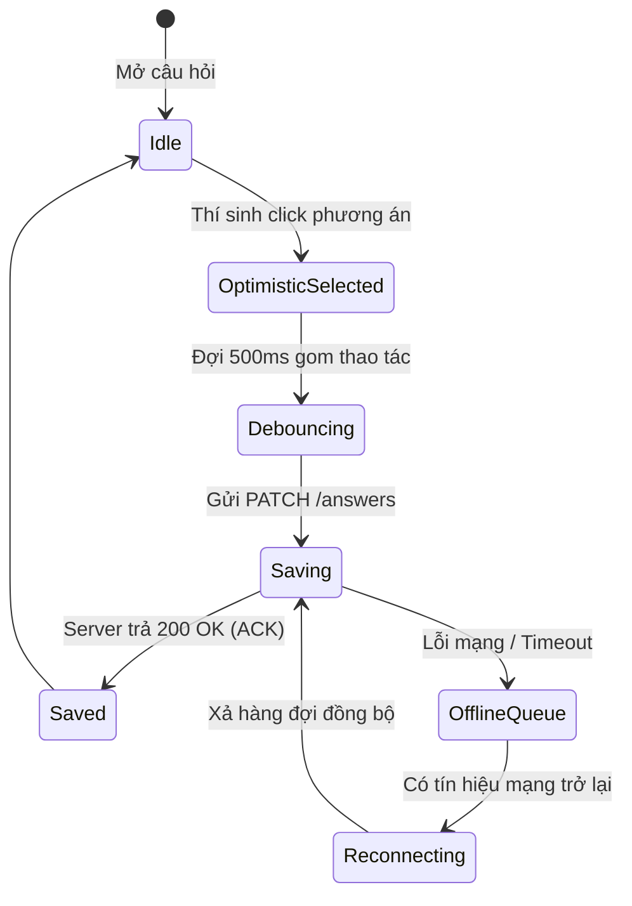

# 🎯 Đặc Tả Chuyên Sâu & Wireframe: Phòng Thi Tập Trung (05-FOCUS-EXAM-ROOM-SPEC)

**Dự án**: ThiSmart (Exam Platform)  
**Đường dẫn**: `docs/05-frontend/wireframe/05-FOCUS-EXAM-ROOM-SPEC.md`  
**Thương hiệu & Bản sắc**: **ThiSmart Concept 03 — Minimal Tech / Modern EdTech** (Chi tiết: [`THISMART_BRAND_GUIDELINES.md`](../THISMART_BRAND_GUIDELINES.md))  
**Slogan**: *Thi thông minh. Đánh giá chính xác.*  
**Màn hình mục tiêu**: `SCR-STU-03: Focus Exam Room` (`/exam/[attemptId]`)  
**Tài liệu liên quan**:
- Backend API: [`GET /api/v1/exam-attempts/{id}`](../../03-architecture-api/12-API_DESIGN.md), [`PATCH /api/v1/exam-attempts/{id}/answers`](../../03-architecture-api/12-API_DESIGN.md), [`POST /api/v1/exam-attempts/{id}/submit`](../../03-architecture-api/12-API_DESIGN.md), [`POST /api/v1/exam-attempts/{id}/proctoring-events`](../../03-architecture-api/12-API_DESIGN.md)
- Cơ sở dữ liệu: [`exam_attempts`](../../02-domain-database/09-DATABASE_DESIGN.md), [`attempt_answers`](../../02-domain-database/09-DATABASE_DESIGN.md), [`questions`](../../02-domain-database/09-DATABASE_DESIGN.md), [`proctoring_events`](../../02-domain-database/09-DATABASE_DESIGN.md)

---

## 1. Triết Lý Thiết Kế: Focus Exam Shell

Phòng thi trực tuyến là môi trường đòi hỏi sự tập trung cao độ và tính ổn định tuyệt đối:
1. **Không phân tâm (Distraction-Free Environment)**: Loại bỏ hoàn toàn Sidebar, Header chính của cổng thông tin, menu điều hướng ngoài và thanh chân trang (Footer).
2. **Độ tin cậy cao hơn hoạt ảnh (Reliability Over Animation)**: Không sử dụng animation hào nhoáng gây giật lag máy yếu; ưu tiên hiển thị trạng thái lưu trữ chính xác và rõ ràng.
3. **Bảo toàn dữ liệu tối đa**: Không bao giờ để mất câu trả lời của thí sinh kể cả khi rớt mạng đột ngột hay mất điện.
4. **Bảo mật tuyệt đối (Zero-Leakage Policy)**: Thí sinh tuyệt đối không nhận được `correct_answer`, `explanation` hay điểm số câu hỏi trong toàn bộ thời gian làm bài.

---

## 2. Wireframe Bố Cục Desktop Tiêu Chuẩn (1440px+)

```text
┌─────────────────────────────────────────────────────────────────────────────────────────────┐
│ [Logo Mark] ThiSmart | Lập trình Web - K21                    Thí sinh: Nguyễn Văn A (SV101)│
│                       ⏱ 45:12 còn lại  •  ✓ Đã lưu tất cả thay đổi (Cloud Icon)             │
├─────────────────────────────────────────────────────────────────────────────────────────────┤
│ Tiến độ: 28 / 40 câu [████████████████████████░░░░░░░░░░░] 70%  • Tự động đồng bộ với máy chủ│
├──────────────────────────────────────────────────────────────┬──────────────────────────────┤
│ ┌─ KHUNG HIỂN THỊ CÂU HỎI (QUESTION CARD - 70%) ───────────┐ │ ┌─ QUESTION PALETTE (30%) ──┐│
│ │ CÂU HỎI 15 / 40          [0.25 điểm]   [ ⚑ Đánh dấu xem lại] │ │ Đã làm: 28  •  Chưa làm: 12││
│ │                                                          │ │                             ││
│ │ CÂU HỎI TRẮC NGHIỆM ĐƠN LỰA CHỌN (SINGLE CHOICE)         │ │ [01][02][03][04][05] (Blue) ││
│ │                                                          │ │ [06][07][08][09][10]        ││
│ │ Trong kiến trúc RESTful API, phương thức HTTP nào có tính│ │ [11][12][13][14][(15)](Ring)││
│ │ chất Idempotent và thường được sử dụng để thay thế toàn  │ │ [16][17][18][19][20]        ││
│ │ bộ nội dung của tài nguyên đích?                         │ │ ...                         ││
│ │                                                          │ │ [36][37][38][39][40] (Gray) ││
│ │ ( ) A. POST                                              │ │                             ││
│ │ (●) B. PUT            [✓ Selected Viền xanh + Nền mềm]   │ │ CHÚ THÍCH TRẠNG THÁI:       ││
│ │ ( ) C. PATCH                                             │ │ ■ [Xanh] Đã trả lời (28)    ││
│ │ ( ) D. DELETE                                            │ │ □ [Trắng] Chưa làm (12)     ││
│ │                                                          │ │ ⚑ [Cờ Vàng] Xem lại (03)    ││
│ │ ℹ Chọn một đáp án. Bạn có thể thay đổi trước khi nộp.   │ │                             ││
│ │                             [ Bỏ chọn đáp án câu này ]   │ │ [=========================] ││
│ └──────────────────────────────────────────────────────────┘ │ [  📤 NỘP BÀI THI (Danger) ] ││
│                                                              │ [=========================] ││
│                                                              │ Có hộp thoại xác nhận 2 bước││
│                                                              └─────────────────────────────┘│
├─────────────────────────────────────────────────────────────────────────────────────────────┤
│ [ ← Câu trước (Phím ←) ]        Phím tắt: [1-4] Chọn đáp án • [F] Đánh dấu     [ Câu tiếp theo → ]│
└─────────────────────────────────────────────────────────────────────────────────────────────┘
```

---

## 3. Wireframe Bố Cục Tablet & Mobile Responsive

### 3.1. Bố Cục Tablet (768px – 1024px)
Trên màn hình Tablet, thanh điều hướng `Question Palette` được ẩn vào một nút bấm **"Bảng câu hỏi (Grid Icon)"** ở thanh đáy; khi click sẽ trượt ra dưới dạng **Off-canvas Drawer** từ bên phải màn hình.

### 3.2. Bố Cục Mobile (< 768px)
```text
┌─────────────────────────────────────────┐
│ [Logo] Web K21           ⏱ 45:12 còn lại │
│ Tiến độ: 28/40 câu [███████░░░]  ✓ Đã lưu│
├─────────────────────────────────────────┤
│ CÂU 15 / 40   (0.25đ)   [ ⚑ Đánh dấu ]  │
│                                         │
│ Trong RESTful API, phương thức HTTP nào │
│ có tính chất Idempotent để thay thế tài │
│ nguyên đích?                            │
│                                         │
│ ┌─────────────────────────────────────┐ │
│ │ ( ) A. POST                         │ │
│ └─────────────────────────────────────┘ │
│ ┌─────────────────────────────────────┐ │
│ │ (●) B. PUT  [✓ Nền xanh viền đậm]   │ │
│ └─────────────────────────────────────┘ │
│ ┌─────────────────────────────────────┐ │
│ │ ( ) C. PATCH                        │ │
│ └─────────────────────────────────────┘ │
│ ┌─────────────────────────────────────┐ │
│ │ ( ) D. DELETE                       │ │
│ └─────────────────────────────────────┘ │
│                                         │
│ [ Bỏ chọn đáp án ]                      │
├─────────────────────────────────────────┤
│ [ ← Trước ]  [ 📋 15/40 ]  [ Tiếp theo →]│
│ [=========== NỘP BÀI THI ===============]│
└─────────────────────────────────────────┘
```

---

## 4. Đặc Tả Giao Diện 4 Loại Câu Hỏi (Option Cards Specs)

### 4.1. Câu hỏi Trắc nghiệm 1 Đáp án (`single_choice`)
- **Điều khiển**: `<input type="radio" name="question_{id}">`.
- **Thao tác**: Click toàn bộ thẻ Card phương án để chọn.
- **Trạng thái**:
  - `Default`: Viền xám nhạt `#E2E8F0`, nền trắng.
  - `Hover`: Viền xanh nhạt `#B6CAF4`, nền `#FAFCFF`.
  - `Selected`: Viền xanh `#2563EB` 2px, nền `#EFF6FF`, chấm radio màu xanh có check icon.
  - Có nút `Bỏ chọn đáp án` để xóa lựa chọn nếu thí sinh muốn để trống.

### 4.2. Câu hỏi Trắc nghiệm Nhiều Đáp án (`multiple_choice`)
- **Điều khiển**: `<input type="checkbox">`.
- **Chỉ dẫn giao diện**: Kèm dòng thông báo: *"Chọn tất cả các phương án đúng. Câu hỏi có thể có nhiều hơn 1 đáp án."*
- **Trạng thái**: Cho phép tích chọn hoặc bỏ chọn độc lập nhiều phương án A, B, C, D...

### 4.3. Câu hỏi Đúng / Sai (`true_false`)
- **Điều khiển**: 2 nút Card lớn dạng Split Button:
```text
┌──────────────────────────────┐  ┌──────────────────────────────┐
│       [ ✓ ] ĐÚNG (TRUE)      │  │        [ ✗ ] SAI (FALSE)     │
└──────────────────────────────┘  └──────────────────────────────┘
```

### 4.4. Câu hỏi Điền khuyết / Trả lời Ngắn (`short_answer`)
- **Điều khiển**: Ô nhập liệu Textarea có giới hạn số từ/ký tự:
```text
┌─────────────────────────────────────────────────────────────┐
│ Câu trả lời của bạn:                                        │
│ [ SELECT * FROM exam_attempts WHERE id = ? FOR UPDATE;    ] │
│                                                             │
│ Số ký tự: 52 / 500 ký tự       •       [ ✓ Đã lưu tự động ] │
└─────────────────────────────────────────────────────────────┘
```

---

## 5. Đồng Hồ Tính Giờ Chuẩn Máy Chủ (Server-Authoritative Clock)

### 5.1. Công thức Tính Toán Hạn Chót
Thời gian kết thúc làm bài thi được chốt cứng bởi máy chủ Backend:
$$\text{deadline} = \min(\text{started\_at} + \text{duration\_minutes}, \text{session.end\_at})$$

### 5.2. Thuật toán Đồng Bộ Đồng Hồ Client
Khi nhận dữ liệu từ `GET /api/v1/exam-attempts/{id}`:
```typescript
// 1. Tính toán độ lệch giữa đồng hồ máy tính thí sinh và đồng hồ máy chủ
const serverNow = new Date(response.serverNow).getTime();
const clientNow = Date.now();
const timeOffset = serverNow - clientNow;

// 2. Hàm lấy thời gian chuẩn xác thực
function getSynchronizedNow() {
  return Date.now() + timeOffset;
}

// 3. Tính số giây còn lại
const remainingSeconds = Math.max(0, Math.floor((new Date(response.deadlineAt).getTime() - getSynchronizedNow()) / 1000));
```

### 5.3. Các Mốc Trạng Thái Trực Quan của Bộ Đếm Giờ (Timer Visual States)
- **Bình thường (> 10 phút)**: Nền xanh nhạt `#F8FBFF`, chữ xám `#334155`.
- **Cảnh báo (Còn 10 phút & 5 phút)**: Chuyển sang màu vàng cam `#FFF7ED`, viền `#FED7AA`, icon đồng hồ nhấp nháy nhẹ 1 lần kèm Toast thông báo nhỏ. **Tuyệt đối không bật modal chặn màn hình làm bài**.
- **Khẩn cấp (Còn < 1 phút)**: Chữ màu đỏ `#B91C1C`, phông chữ `tabular-nums` đếm từng giây.
- **Hết giờ (00:00)**: Tự động kích hoạt cơ chế `Auto-Submit`:
  - Khóa toàn bộ các ô chọn đáp án.
  - Hiển thị thông báo: *"Đã hết thời gian làm bài thi. Đang tự động nộp bài..."*.
  - Gửi yêu cầu nộp bài cuối cùng lên Backend.

---

## 6. Động Cơ Autosave (Debounced Autosave Engine) & Bảng Trạng Thái Lưu

### 6.1. Sơ Đồ Trạng Thái Đồng Bộ Đáp Án


### 6.2. Hiển Thị Huy Hiệu Trạng Thái Lưu (Save State Badges)
| Trạng thái | Biểu tượng (Icon) | Nhãn hiển thị | Màu sắc | Ý nghĩa |
| :--- | :---: | :--- | :--- | :--- |
| `saved` | `CloudCheck` | `✓ Đã lưu tất cả thay đổi` | Xanh lá (`#15803D`) | Dữ liệu đã an toàn trên PostgreSQL. |
| `saving` | `Spinner` | `Đang lưu đáp án...` | Xanh dương (`#2563EB`) | Request đang bay trên đường truyền. |
| `offline` | `CloudOff` | `⚠ Chưa đồng bộ (Mất mạng)` | Vàng cam (`#B45309`) | Đáp án lưu tạm tại bộ nhớ hàng đợi Client. |
| `error` | `AlertCircle`| `Lỗi lưu đáp án! Nhấn để thử lại` | Đỏ (`#B91C1C`) | Xung đột phiên hoặc lỗi máy chủ. |

---

## 7. Cảm Biến Giám Sát Phòng Thi (Proctoring Sensors & Event Collectors)

Hệ thống triển khai phòng thủ theo chiều sâu thông qua các Event Listeners của Web APIs:

```typescript
// 1. Cảm biến chuyển tab hoặc ẩn trình duyệt
document.addEventListener("visibilitychange", () => {
  if (document.visibilityState === "hidden") {
    recordProctoringEvent("tab_hidden", "medium", {
      reason: "Thí sinh chuyển sang tab khác hoặc thu nhỏ cửa sổ",
    });
  }
});

// 2. Cảm biến thoát chế độ toàn màn hình
document.addEventListener("fullscreenchange", () => {
  if (!document.fullscreenElement) {
    recordProctoringEvent("fullscreen_exit", "medium", {
      reason: "Thí sinh bấm Esc hoặc thoát Toàn màn hình",
    });
  }
});

// 3. Cảm biến click ra ngoài cửa sổ thi
window.addEventListener("blur", () => {
  recordProctoringEvent("window_blur", "low", {
    reason: "Cửa sổ thi bị mất tiêu điểm (Focus lost)",
  });
});
```

- **Xử lý Toast Cảnh báo**: Khi thí sinh vi phạm, hiển thị Toast viền vàng:
  > *"⚠ Cảnh báo giám sát: Bạn vừa rời khỏi màn hình bài thi. Hành vi này đã được ghi lại trong nhật ký của Giám thị!"*
- **Rate-Limiting Client**: Không gửi quá 1 sự kiện cảm biến trong vòng 3 giây để tránh làm ngập tràn mạng (Spam DOS).

---

## 8. Hàng Đợi Phục Hồi Sau Mất Kết Nối (Offline Resilience Engine)

Khi mất kết nối mạng đột ngột (rớt Wi-Fi, đứt cáp):
1. Giao diện xuất hiện thanh Banner cảnh báo màu cam cố định trên đỉnh trang:
   ```text
   [ ⚠ MẤT KẾT NỐI MẠNG ] Câu trả lời mới của bạn đang được lưu tạm an toàn trên máy tính. Hệ thống sẽ tự động đồng bộ ngay khi có mạng trở lại. Vui lòng không đóng trình duyệt!
   ```
2. Mọi thao tác chọn đáp án mới được đưa vào hàng đợi `mutationQueue` trong bộ nhớ cục bộ.
3. Nút **"Nộp bài thi"** bị vô hiệu hóa kèm tooltip: *"Cần có kết nối Internet để nộp bài."*
4. Khi trình duyệt phát sự kiện `window.addEventListener('online')`:
   - Hệ thống tự động xả hàng đợi, gọi API đồng bộ toàn bộ đáp án còn thiếu theo thứ tự thời gian.
   - Khi hoàn tất, banner mất mạng biến mất và hiển thị badge: `✓ Đã kết nối lại và đồng bộ thành công!`.
