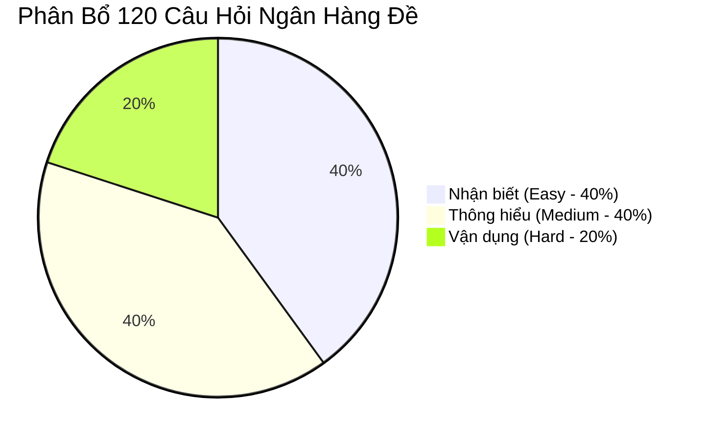
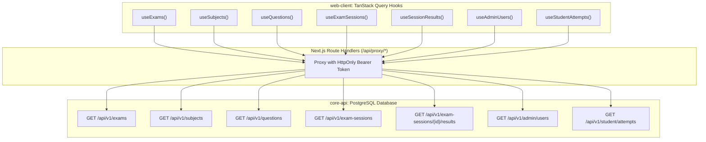
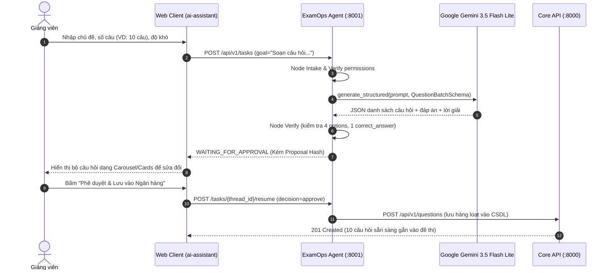
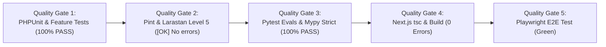

# 25 — Đặc Tả Kỹ Thuật Chi Tiết & Kế Hoạch Thực Thi 4 Sprint (Sprint Execution Specification)

**Dự án**: Exam Platform Monorepo (`core-api` + `web-client` + `agentic-system`)  
**Tài liệu**: `docs/07-testing-execution/25-SPRINT_EXECUTION_SPECIFICATION.md`  
**Liên kết Kế hoạch tổng thể**: [`PROJECT_IMPROVEMENT_PLAN.md`](../../PROJECT_IMPROVEMENT_PLAN.md)  
**Tiêu chuẩn tuân thủ**: [`AGENTS.md`](../../AGENTS.md), [`12-API_DESIGN.md`](../03-architecture-api/12-API_DESIGN.md), [`19-TEST_STRATEGY.md`](19-TEST_STRATEGY.md)  
**Mục tiêu**: Chuẩn bị đầy đủ đặc tả API, lược đồ CSDL, cấu trúc DTO/Pydantic, giao thức kết nối Frontend và kịch bản kiểm thử tự động để bắt tay vào triển khai từng Sprint.

---

## 📑 Mục Lục
1. [Kiến Trúc Tổng Thể & Ranh Giới 4 Sprint](#1-kiến-trúc-tổng-thể--ranh-giới-4-sprint)
2. [Sprint 1: Hoàn Thiện Core API & Ngân Hàng 120+ Câu Hỏi Mẫu](#2-sprint-1-hoàn-thiện-core-api--ngân-hàng-120-câu-hỏi-mẫu)
3. [Sprint 2: Chuẩn Hóa Điều Hướng RBAC & Xóa Bỏ Toàn Bộ Mock UI](#3-sprint-2-chuẩn-hóa-điều-hướng-rbac--xóa-bỏ-toàn-bộ-mock-ui)
4. [Sprint 3: AI Copilot Tự Động Biên Soạn Câu Hỏi Mới Bằng Gemini LLM](#4-sprint-3-ai-copilot-tự-động-biên-soạn-câu-hỏi-mới-bằng-gemini-llm)
5. [Sprint 4: Phòng Thi Focus Mode Thật, Watermark Chống Tuồn Đề & Script 1-Click](#5-sprint-4-phòng-thi-focus-mode-thật-watermark-chống-tuồn-đề--script-1-click)
6. [Kế Hoạch Kiểm Thử Tự Động & Tiêu Chí Nghiệm Thu (DoD)](#6-kế-hoạch-kiểm-thử-tự-động--tiêu-chí-nghiệm-thu-dod)

---

## 1. Kiến Trúc Tổng Thể & Ranh Giới 4 Sprint

```mermaid
flowchart TD
    subgraph Sprint1["Sprint 1: Core API Completeness & Rich Seeding"]
        S1_1["AdminUserController (CRUD Users, Status Toggle)"]
        S1_2["AdminAuditLogController & AdminStatsController"]
        S1_3["Bổ sung CRUD khuyết: Exams, Questions, Topics, Student Attempts"]
        S1_4["QuestionSeeder: 120+ câu hỏi mẫu phủ 3 môn & 4 định dạng"]
    end

    subgraph Sprint2["Sprint 2: Strict RBAC Navigation & Live Frontend Data"]
        S2_1["AppSidebar & TopBar: Lọc menu nghiêm ngặt theo user.role"]
        S2_2["Teacher Workspace: Live TanStack Hooks (Subjects, Questions, Exams, Sessions, Results)"]
        S2_3["Admin Workspace: Live TanStack Hooks (Users, Audit Logs, Settings)"]
        S2_4["Dashboard: Hiển thị đúng user.name và số liệu thống kê CSDL thật"]
    end

    subgraph Sprint3["Sprint 3: AI Question Generator Skill (agentic-system)"]
        S3_1["Pydantic Schemas: QuestionGenerationRequest, BatchProposal"]
        S3_2["LangGraph Skill: question-generation với Gemini 3.5 Flash Lite"]
        S3_3["Schema Dereferencer: Làm phẳng $defs cho generationConfig.responseSchema"]
        S3_4["Teacher UI: Tab Soạn Câu Hỏi AI + Human Review Gate + Lưu vào CSDL"]
    end

    subgraph Sprint4["Sprint 4: Student Exam Flow, Watermark & Dev Automation"]
        S4_1["Focus Exam Room: Live questions, Autosave debounce 500ms, Server Clock"]
        S4_2["Dynamic Anti-Leak Watermark: Lớp phủ mã SV + Ca thi + IP + Timestamp"]
        S4_3["Student Results: Xem chi tiết điểm bài thi và lịch sử các lần thi"]
        S4_4["start-dev.ps1: Script 1-click khởi chạy đồng thời 3 phân hệ kèm healthcheck"]
    end

    Sprint1 --> Sprint2
    Sprint2 --> Sprint3
    Sprint3 --> Sprint4
```



---

## 2. Sprint 1: Hoàn Thiện Core API & Ngân Hàng 120+ Câu Hỏi Mẫu

### 2.1. Phân Hệ Quản Trị Viên (`/api/v1/admin/*`)

#### A. Quản lý Người dùng (`AdminUserController.php`)
- **`GET /api/v1/admin/users`**:
  - **Mục đích**: Danh sách tài khoản người dùng toàn trường phục vụ quản trị.
  - **Phân quyền**: `middleware(['auth:sanctum', 'active', 'role:admin'])`.
  - **Query Parameters**:
    - `search` (string, max 100): Tìm kiếm theo tên (`name`), email (`email`), hoặc mã định danh (`code`).
    - `role` (`student` | `teacher` | `admin`): Lọc theo vai trò.
    - `is_active` (`true` | `false`): Lọc theo trạng thái hoạt động.
    - `page` (int, default 1), `per_page` (int, 1-100, default 20).
  - **Response `200 OK`**:
    ```json
    {
      "data": [
        {
          "id": 3,
          "name": "TS. Lê Hoàng Nam",
          "email": "teacher@examplatform.local",
          "code": "GV0001",
          "role": "teacher",
          "is_active": true,
          "created_at": "2026-10-15T08:00:00Z",
          "updated_at": "2026-10-27T10:00:00Z"
        }
      ],
      "meta": { "current_page": 1, "per_page": 20, "total": 25, "last_page": 2 },
      "links": { "first": "...", "last": "...", "prev": null, "next": "..." }
    }
    ```
- **`POST /api/v1/admin/users`**:
  - **Form Request**: `StoreAdminUserRequest`.
  - **Validation Rules**:
    ```php
    return [
        'name' => ['required', 'string', 'max:255'],
        'email' => ['required', 'string', 'email:rfc,dns', 'max:255', 'unique:users,email'],
        'code' => ['required', 'string', 'max:50', 'unique:users,code'],
        'role' => ['required', new Enum(UserRole::class)],
        'password' => ['required', 'string', 'min:8', 'max:100'],
        'is_active' => ['sometimes', 'boolean'],
    ];
    ```
  - **Response `201 Created`**: Trả về `UserAdminResource` kèm mã người dùng mới tạo.
- **`PATCH /api/v1/admin/users/{user}`**:
  - **Form Request**: `UpdateAdminUserRequest`.
  - **Validation Rules**:
    ```php
    return [
        'name' => ['sometimes', 'string', 'max:255'],
        'email' => ['sometimes', 'string', 'email:rfc,dns', 'max:255', Rule::unique('users', 'email')->ignore($this->route('user'))],
        'code' => ['sometimes', 'string', 'max:50', Rule::unique('users', 'code')->ignore($this->route('user'))],
        'role' => ['sometimes', new Enum(UserRole::class)],
        'is_active' => ['sometimes', 'boolean'],
        'password' => ['sometimes', 'string', 'min:8', 'max:100'],
    ];
    ```
  - **Quy tắc an toàn**: Chặn không cho Admin tự khóa chính mình hoặc tước quyền Admin của chính mình (`$user->id === $actor->id && $request->has('is_active') && !$request->boolean('is_active')` $\rightarrow$ `422 UNPROCESSABLE_ENTITY`).

#### B. Nhật ký Kiểm toán Hợp nhất (`AdminAuditLogController.php`)
- **`GET /api/v1/admin/audit-logs`**:
  - **Mục đích**: Tổng hợp nhật ký an ninh, bao gồm:
    1. Các tác vụ do AI Copilot thực thi từ bảng `ai_generation_logs`.
    2. Các sự kiện vi phạm giám sát phòng thi nghiêm trọng (`severity = high`) từ bảng `proctoring_events`.
    3. Nhật ký đóng/mở ca thi từ bảng `exam_sessions`.
  - **Response `200 OK`**:
    ```json
    {
      "data": [
        {
          "id": "log_ai_1",
          "category": "ai_copilot",
          "action": "EXAM_BLUEPRINT_APPLIED",
          "actor": { "id": 3, "name": "TS. Lê Hoàng Nam", "role": "teacher" },
          "description": "Đề thi '#4: Đề thi Giữa kỳ Web Nâng Cao' được phê duyệt và lưu vào CSDL",
          "thread_id": "thread_10f1af8f85d6",
          "severity": "info",
          "timestamp": "2026-10-27T09:33:01Z"
        },
        {
          "id": "log_proc_82",
          "category": "proctoring",
          "action": "MULTIPLE_FACES_DETECTED",
          "actor": { "id": 6, "name": "Nguyễn Văn An", "role": "student" },
          "description": "Phát hiện nhiều khuôn mặt trong phòng thi ca SES-101",
          "severity": "high",
          "timestamp": "2026-10-27T08:15:22Z"
        }
      ],
      "meta": { "total": 45, "current_page": 1, "per_page": 20 }
    }
    ```

#### C. Bảng Điều Khiển Quản Trị Hệ Thống (`AdminStatsController.php`)
- **`GET /api/v1/admin/dashboard-stats`**:
  - **Mục đích**: Thống kê chỉ số thời gian thực (Real-time Metrics) cho trang `/admin`.
  - **Response `200 OK`**:
    ```json
    {
      "data": {
        "users": { "total": 25, "students": 20, "teachers": 3, "admins": 2, "inactive": 0 },
        "academics": { "total_subjects": 3, "total_topics": 8, "total_questions": 120 },
        "exams": { "total_blueprints": 4, "total_sessions": 3, "active_sessions": 1 },
        "attempts": { "total_attempts": 18, "submitted": 16, "in_progress": 2 },
        "security_alerts_today": 3
      }
    }
    ```

---

### 2.2. Bổ Sung Các Endpoint CRUD Còn Khuyết

| Controller | Phương thức HTTP & URI | Quyền truy cập | Ràng buộc nghiệp vụ (Business Constraints) |
| :--- | :--- | :--- | :--- |
| **`TopicController`** | `PATCH /api/v1/topics/{topic}` | Teacher phụ trách, Admin | Sửa tên và mô tả chủ đề. Tên không được trùng trong cùng một môn học. |
| **`TopicController`** | `DELETE /api/v1/topics/{topic}` | Teacher phụ trách, Admin | Kiểm tra `questions_count`. Nếu đã có câu hỏi gắn với Topic $\rightarrow$ trả về `409 CONFLICT` với mã `TOPIC_HAS_QUESTIONS`. |
| **`ExamController`** | `GET /api/v1/exams/{exam}` | Teacher phụ trách, Admin | Eager loading danh sách câu hỏi đã gắn (`questions.topic`), thứ tự và điểm số từng câu. |
| **`ExamController`** | `PATCH /api/v1/exams/{exam}` | Teacher phụ trách, Admin | Cho phép sửa tiêu đề, thời lượng, điểm sàn nếu chưa có ca thi nào gắn với đề. |
| **`ExamController`** | `DELETE /api/v1/exams/{exam}` | Teacher phụ trách, Admin | Nếu đề thi đã được gắn vào ca thi (`exam_sessions_count > 0`) $\rightarrow$ từ chối xóa `409 CONFLICT` với mã `EXAM_HAS_SESSIONS`. |
| **`QuestionController`**| `GET /api/v1/questions/{question}` | Teacher phụ trách, Admin | Lấy chi tiết câu hỏi (gồm cả đáp án đúng và lời giải thích) để nạp vào form chỉnh sửa. |
| **`QuestionController`**| `DELETE /api/v1/questions/{question}` | Teacher phụ trách, Admin | Soft delete câu hỏi. Nếu câu hỏi đã gắn vào đề thi $\rightarrow$ chuyển trạng thái sang `disabled` thay vì xóa cứng. |
| **`StudentExamSessionController`** | `GET /api/v1/student/attempts` | Student | Lấy danh sách lịch sử tất cả các lượt làm bài của sinh viên đang đăng nhập kèm điểm số và trạng thái. |

---

### 2.3. Quy Chuẩn Bộ Ngân Hàng 120+ Câu Hỏi Mẫu (`QuestionSeeder.php`)

Nâng cấp `QuestionSeeder.php` tạo đầy đủ **120 câu hỏi chất lượng cao** (40 câu/môn), bao phủ cả 4 định dạng câu hỏi và 3 cấp độ Bloom:



- **Môn 1: `IT4409` — Kiến trúc Máy tính & Lập trình Web Nâng cao (40 câu)**:
  - Topic 1: *CPU, ALU & Pipeline Architecture* (14 câu: 6 Dễ, 6 Vừa, 2 Khó)
  - Topic 2: *Bộ nhớ Cache, Phân cấp & Virtual Memory* (13 câu: 5 Dễ, 5 Vừa, 3 Khó)
  - Topic 3: *RESTful API, HTTP Methods & Microservices* (13 câu: 5 Dễ, 5 Vừa, 3 Khó)
- **Môn 2: `IT3080` — Mạng Máy tính & An toàn Mạng (40 câu)**:
  - Topic 1: *Mô hình OSI & TCP/IP Protocol Suite* (14 câu: 6 Dễ, 6 Vừa, 2 Khó)
  - Topic 2: *Giao thức Tầng Giao vận & Bắt tay 3 bước TCP/UDP* (13 câu: 5 Dễ, 5 Vừa, 3 Khó)
  - Topic 3: *Định tuyến IP, Subnetting CIDR & NAT* (13 câu: 5 Dễ, 5 Vừa, 3 Khó)
- **Môn 3: `IT3290` — Cơ sở Dữ liệu & Tối ưu Hóa Query (40 câu)**:
  - Topic 1: *Đại số Quan hệ & Ngôn ngữ Truy vấn SQL Nâng cao* (14 câu: 6 Dễ, 6 Vừa, 2 Khó)
  - Topic 2: *Giao dịch ACID, Mức độ Cô lập & Khóa Bi quan (Pessimistic Locking)* (13 câu: 5 Dễ, 5 Vừa, 3 Khó)
  - Topic 3: *Chỉ mục B-Tree, Explain Analyze & Phân vùng Dữ liệu (Partitioning)* (13 câu: 5 Dễ, 5 Vừa, 3 Khó)

---

## 3. Sprint 2: Chuẩn Hóa Điều Hướng RBAC & Xóa Bỏ Toàn Bộ Mock UI

### 3.1. Phân Tách Giao Diện Theo Role Đăng Nhập

#### A. Tái cấu trúc [`AppSidebar.tsx`](web-client/src/components/workspace/AppSidebar.tsx)
- Đọc `const { user } = useCurrentUser();`.
- **Nếu `user?.role === 'student'`**:
  ```typescript
  const STUDENT_NAV_ITEMS = [
    { label: "Ca thi của tôi", href: "/student/exams", icon: Calendar, badge: "1 Mở" },
    { label: "Kết quả & Lịch sử thi", href: "/student/results", icon: BarChart3 },
  ];
  ```
- **Nếu `user?.role === 'teacher'`**:
  ```typescript
  const TEACHER_NAV_ITEMS = [
    { label: "Tổng quan Giảng viên", href: "/teacher", icon: LayoutDashboard },
    { label: "Môn học & Chủ đề", href: "/teacher/subjects", icon: BookOpen },
    { label: "Ngân hàng Câu hỏi", href: "/teacher/questions", icon: HelpCircle },
    { label: "Trợ lý Soạn Đề AI", href: "/teacher/ai-assistant", icon: Sparkles, badge: "AI 2.0" },
    { label: "Kho Đề thi mẫu", href: "/teacher/exams", icon: FileText },
    { label: "Lập lịch Ca thi", href: "/teacher/sessions", icon: Calendar },
    { label: "Giám sát Trực tiếp", href: "/teacher/sessions", icon: Radio, badge: "LIVE" },
  ];
  ```
- **Nếu `user?.role === 'admin'`**:
  ```typescript
  const ADMIN_NAV_ITEMS = [
    { label: "Tổng quan Quản trị", href: "/admin", icon: LayoutDashboard },
    { label: "Quản trị Người dùng", href: "/admin/users", icon: Users },
    { label: "Nhật ký Kiểm toán", href: "/admin/audit-logs", icon: ShieldCheck },
    { label: "Cấu hình Hệ thống", href: "/admin/settings", icon: Settings },
  ];
  ```
- Loại bỏ hoàn toàn thanh tab giả lập `"Tất cả | SV | GV | Admin"`.

#### B. Tái cấu trúc [`TopBar.tsx`](web-client/src/components/workspace/TopBar.tsx)
- Loại bỏ 3 nút chuyển phân hệ demo (`Sinh viên | Giảng viên | Quản trị`).
- Hiển thị thông tin chính thức:
  - Tên đầy đủ: `{user?.name || "Đang tải..."}`
  - Mã định danh & Role Badge: `{user?.code} • {ROLE_LABELS[user?.role]}`
  - Nút Đăng xuất (`useLogout`) gọi API thu hồi token và xóa sạch cookie.

---

### 3.2. Danh Mục Chuyển Đổi Mock $\rightarrow$ Live API Trên 8 Màn Hình



1. **`teacher/exams/page.tsx`**:
   - Xóa `MOCK_EXAM_TEMPLATES`.
   - Sử dụng `useQuery({ queryKey: ['exams'], queryFn: fetchExams })`.
   - Kết nối nút "Xóa đề thi" với `useMutation(deleteExam)`.
   - Kết nối nút "Xuất PDF" tải file trực tiếp từ `/api/proxy/exams/{id}/export/pdf`.
2. **`teacher/subjects/page.tsx`**:
   - Xóa `INITIAL_SUBJECTS`.
   - Sử dụng `useQuery({ queryKey: ['subjects'], queryFn: fetchSubjects })`.
   - Modal Thêm/Sửa Môn học và Chủ đề kết nối trực tiếp với backend endpoints.
3. **`teacher/questions/page.tsx`**:
   - Xóa `MOCK_QUESTIONS`.
   - Sử dụng `useQuery({ queryKey: ['questions', filters], queryFn: () => fetchQuestions(filters) })`.
   - Bổ sung bộ lọc theo Môn học (`subject_id`), Chủ đề (`topic_id`), Mức độ (`difficulty`), Trạng thái (`status`).
4. **`teacher/sessions/page.tsx`**:
   - Xóa `MOCK_SESSIONS`.
   - Sử dụng `useQuery({ queryKey: ['exam-sessions'], queryFn: fetchSessions })`.
   - Nút "Mở ca thi" gọi `POST /api/proxy/exam-sessions/{id}/publish`.
   - Nút "Đóng ca thi" gọi `POST /api/proxy/exam-sessions/{id}/close`.
5. **`teacher/sessions/[id]/results/page.tsx`**:
   - Xóa `MOCK_RESULTS`.
   - Sử dụng `useQuery({ queryKey: ['session-results', sessionId], queryFn: () => fetchSessionResults(sessionId) })`.
   - Vẽ biểu đồ cột phân phối điểm thực tế từ `analytics.score_distribution_buckets`.
6. **`admin/users/page.tsx`**:
   - Kết nối với `useQuery({ queryKey: ['admin-users', params], queryFn: () => fetchAdminUsers(params) })`.
   - Form Thêm người dùng mới và Cập nhật trạng thái `is_active`.
7. **`student/results/page.tsx`**:
   - Xóa `MOCK_PAST_RESULTS`.
   - Sử dụng `useQuery({ queryKey: ['student-attempts'], queryFn: fetchStudentAttempts })`.
   - Bấm vào lượt thi chuyển hướng sang trang chi tiết kết quả.

---

## 4. Sprint 3: AI Copilot Tự Động Biên Soạn Câu Hỏi Mới Bằng Gemini LLM

### 4.1. Đặc Tả Kỹ Năng Mới: `question-generation`

Hiện tại Agent chỉ mới sinh khung đề thi. Cần phát triển kỹ năng **Biên soạn câu hỏi trắc nghiệm tự động**:



### 4.2. Pydantic Schemas Cho AI Question Generator

```python
class GeneratedOption(BaseModel):
    id: str = Field(description="Mã định danh duy nhất của phương án, VD: opt_a, opt_b, opt_c, opt_d")
    content: str = Field(description="Nội dung chi tiết của phương án lựa chọn")

class GeneratedQuestion(BaseModel):
    question_text: str = Field(description="Nội dung câu hỏi rõ ràng, chính xác, có tính sư phạm cao")
    question_type: Literal["single_choice", "multiple_choice", "true_false", "short_answer"]
    difficulty: Literal["easy", "medium", "hard"]
    options: list[GeneratedOption] = Field(description="Danh sách phương án (bắt buộc với single_choice và multiple_choice)")
    correct_answer: str | list[str] = Field(description="Mã ID của phương án đúng (hoặc danh sách ID nếu là multiple_choice)")
    explanation: str = Field(description="Lời giải thích học thuật chi tiết lý do phương án này đúng")
    suggested_topic_name: str = Field(description="Tên chủ đề tương ứng trong chương trình đào tạo")

class QuestionBatchProposal(BaseModel):
    subject_code: str
    topic_id: int | str
    total_generated: int
    questions: list[GeneratedQuestion]
```

### 4.3. Bộ Khử Tham Chiếu Schema (`Schema Dereferencer`)
Xây dựng hàm tiện ích giải tham chiếu đệ quy `$defs` trong Pydantic JSON Schema để tương thích 100% với `generationConfig.responseSchema` của Gemini API:
```python
def dereference_json_schema(schema_dict: dict[str, Any]) -> dict[str, Any]:
    """Recursively inlines all $defs references for Gemini API compatibility."""
    # Logic inlining $ref -> resolves to clean OpenAPI 3.0 schema
```

---

## 5. Sprint 4: Phòng Thi Focus Mode Thật, Watermark Chống Tuồn Đề & Script 1-Click

### 5.1. Phòng Thi Trực Tuyến Chống Gian Lận (Focus Exam Room)

1. **Server-Authoritative Clock**:
   - `deadline = min(attempt.started_at + exam.duration_minutes, session.end_at)`.
   - Máy chủ tự động đóng bài thi nếu nộp quá hạn (+15s bù trễ mạng).
2. **Debounced Autosave (500ms)**:
   - Lưu câu trả lời ngay khi người dùng chọn phương án.
   - Hiển thị chỉ báo trạng thái: `Đang đồng bộ...` $\rightarrow$ `Đã lưu trên máy chủ` $\rightarrow$ `Mất kết nối (Lưu đệm offline)`.
3. **Bộ Thu Thập Giám Sát (Proctoring Collector)**:
   - Thu thập hành vi: `visibilitychange` (rời tab), `fullscreenchange` (thoát toàn màn hình), `blur` (mất tiêu điểm cửa sổ).
   - Tự động gửi lên backend: `POST /api/v1/exam-attempts/{id}/proctoring-events`.

### 5.2. Lớp Phủ Dynamic Watermark Chống Tuồn Đề

Phủ một lưới chữ ký số bán trong suốt, xoay nghiêng -25 độ lên toàn bộ màn hình làm bài của thí sinh:
- **Dữ liệu Watermark**: `[Mã Sinh Viên] • [Mã Ca Thi] • [Địa chỉ IP Thí sinh] • [Timestamp thời gian thực]`.
- **CSS Security**: `pointer-events: none`, `user-select: none`, `mix-blend-mode: multiply`.
- **Tamper-Resistance**: Giám sát bằng `MutationObserver`, tự động kích hoạt sự kiện vi phạm giám sát `PROCTORING_TAMPER_DETECTED` nếu thí sinh cố tình xóa phần tử qua DevTools.

### 5.3. Kịch Bản Khởi Chạy 1-Click (`start-dev.ps1`)

Tạo script tại thư mục gốc tự động:
1. Kiểm tra môi trường PHP 8.3+, Python 3.12+, Node.js 20+.
2. Khởi chạy **Laravel Core API** (`http://127.0.0.1:8000`).
3. Khởi chạy **ExamOps FastAPI Agent** (`http://127.0.0.1:8001`).
4. Khởi chạy **Next.js Web Client** (`http://localhost:3000`).
5. Kiểm tra healthcheck đồng thời cả 3 cổng.
6. In bảng hướng dẫn đăng nhập trực quan và giữ tiến trình mở.

---

## 6. Kế Hoạch Kiểm Thử Tự Động & Tiêu Chí Nghiệm Thu (DoD)

Một Sprint chỉ được nghiệm thu khi vượt qua 100% Quality Gates theo Hiến pháp `AGENTS.md`:



### Tiêu chuẩn nghiệm thu chi tiết từng Sprint:
- **Sprint 1**: 100% Feature tests mới cho Admin API và CRUD khuyết PASS. `php artisan migrate:fresh --seed` nạp thành công 120+ câu hỏi không lỗi.
- **Sprint 2**: Không còn bất kỳ hằng số `MOCK_*` nào hiển thị trên giao diện người dùng. Mọi thao tác thêm/sửa/xóa đều cập nhật vào CSDL và giữ nguyên khi tải lại trang (F5).
- **Sprint 3**: Giảng viên bấm "Soạn 10 câu hỏi AI" $\rightarrow$ Gemini LLM sinh câu hỏi trong vòng 5-8s $\rightarrow$ Xem trước và bấm Approve $\rightarrow$ 10 câu hỏi mới xuất hiện ngay trong Ngân hàng đề thi của Core API.
- **Sprint 4**: Thí sinh đăng nhập, hoàn thành bài thi trắc nghiệm trong phòng thi Focus Mode có Watermark, nộp bài thành công và nhận biên nhận điểm số chính xác 100%. Script `start-dev.ps1` khởi chạy toàn bộ hệ thống sau 1 cú click.
