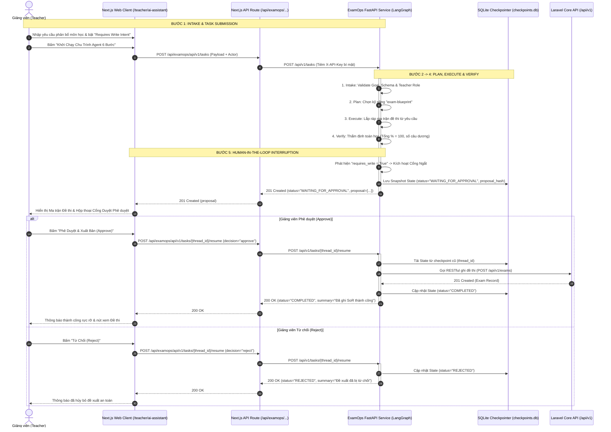
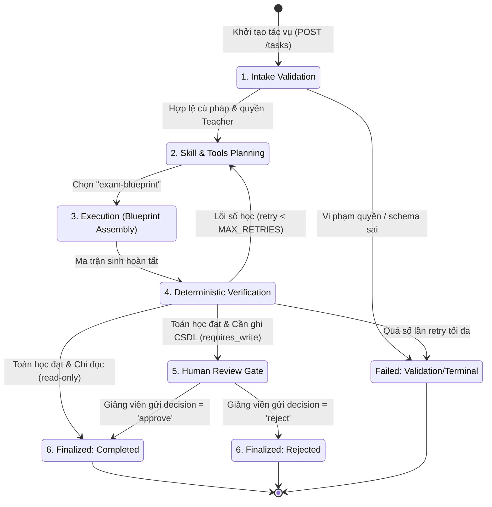
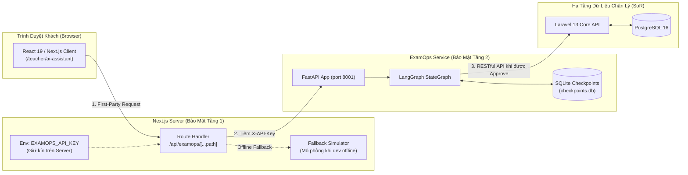

# Sơ đồ Chu trình ExamOps Agent & Cổng Duyệt Human-in-the-Loop

Tài liệu này đặc tả quy trình tương tác giữa **Giảng viên**, **Next.js Web Client**, **FastAPI ExamOps Agent (LangGraph)** và **Core API**, tuân thủ Hiến pháp Kỹ thuật `AGENTS.md` và `ADR-009`.

---

## 1. Sơ Đồ Tuần Tự (Sequence Diagram) — 6-Step Agent Loop

---

## 2. Sơ Đồ Máy Trạng Thái Tác Vụ (State Machine - FSM)

---

## 3. Kiến Trúc Phân Vùng Mạng (Network Boundaries & Zero-Leakage)

